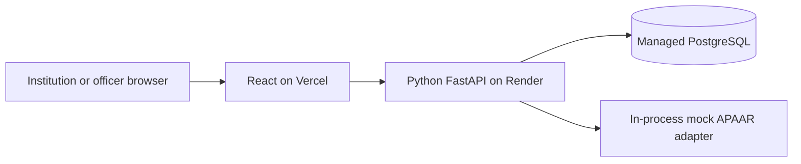

# 02 — Technical design

## 1. Architecture baseline



The core has one API service and one database. The mock is an adapter in that service, not another deployment. No Redis, Celery, separate worker, vector database, or external LLM is required.

Use the current checkout. Cloud tasks are already isolated; do not create a Git worktree unless requested.

## 2. Stack and tools

| Layer | Selection | Notes |
|---|---|---|
| Python | 3.12 | Conservative baseline, not a claim about the latest release. Pin in `.python-version`. |
| Python packages | uv, `pyproject.toml`, `uv.lock` | Lock resolved versions; reproduce with `uv sync --frozen`. |
| HTTP API | FastAPI + Uvicorn | `/api/v1`; generated OpenAPI contract. |
| Input validation | Pydantic v2 + Python `csv` | CSV only in core. No pandas needed. |
| Database | PostgreSQL 16 | Use one managed provider, not two database services. |
| ORM/driver | SQLAlchemy 2 + psycopg 3 | Synchronous sessions and synchronous request handlers for core DB paths. |
| Migrations | Alembic | Run a controlled migration command before serving traffic. |
| Passwords | `pwdlib` with Argon2 support | Hash passwords; no plaintext stored credentials. |
| Tokens | PyJWT with a fixed allowed algorithm | Short-lived signed access tokens. |
| Field protection | `cryptography` AES-GCM + keyed HMAC lookup | Separate encryption and lookup keys. |
| Backend tests | pytest + HTTPX | Use a dedicated PostgreSQL test database for integration tests. |
| Frontend runtime | Node.js 22.12 or higher within pinned Node 22 | Confirm compatibility with the selected Vite release before locking. |
| Web application | React + TypeScript + Vite | Exact compatible releases resolved in the first phase. |
| UI | Tailwind CSS + shadcn/ui + Lucide icons | Review generated components for keyboard access. |
| Routing/data | React Router + TanStack Query | Central request/error handling. |
| Charts | Recharts | Label counts, filters, and data freshness. |
| Frontend packages | npm + `package-lock.json` | `npm ci` for repeatable installs. |
| Frontend checks | TypeScript, ESLint, Vitest/Testing Library | Test meaningful state/error behaviour. |
| Browser smoke | Playwright | One deployed/core journey; avoid broad test expansion. |
| Local runtime | Docker Compose for PostgreSQL | Frontend and API can run on the host. |
| Deployment | Vercel + Render + managed PostgreSQL | Human provisions accounts and approves costs. |

These tools are selections, not verified installed dependencies. At implementation start, check compatibility, pin actual versions, generate locks, and run the first build. Do not select packages solely because they are newest.

## 3. Proposed layout

```text
appar-id/
  docs/
  backend/
    pyproject.toml
    uv.lock
    .python-version
    alembic.ini
    migrations/
    app/
      main.py
      api/              # routes and dependencies
      schemas/          # requests and responses
      services/         # rules, upload, commit, reporting
      repositories/     # scoped queries
      models/
      adapters/         # mock registry; future real adapter
      security/         # auth, encryption, redaction
      fixtures/         # synthetic registry and accounts
    tests/
  frontend/
    package.json
    package-lock.json
    src/
      api/ auth/ components/ pages/ features/
    tests/
  scripts/              # seed, smoke, safe local demo reset
  compose.yaml
  .env.example          # names and harmless examples only
```

Keep business rules in services. Routes authenticate, parse inputs, and call services. Repositories apply explicit scope filters. The frontend does not decide permissions.

## 4. Data model

Use UUID identifiers, UTC timestamps, date columns for business dates, and `Asia/Kolkata` when deriving the business date. Store academic years as validated text, such as `2026-27`.

Read time through an injectable application-clock function. Tests fix that clock; hosted demo uses real time. Seed dates must place the intended active admissions on or before the current demo date. The active metric uses `ENROLLED` records with `start_date <= business_date` and no end date; do not advertise arbitrary historical reporting from current status alone.

| Table | Important data and constraints |
|---|---|
| `institutions` | Internal ID, demo AICTE reference, name, region, state, active status. |
| `users` | Email unique, password hash, role, optional institution ID, active status. Institution role requires institution ID. |
| `programmes` | Institution, programme name, year, approved intake >= 0. Unique institution/name/year. |
| `persons` | Internal ID, unique keyed APAAR digest, encrypted APAAR/name/DOB, masked ID suffix. Only a successful mock identity match links a person. |
| `enrolments` | Institution, programme, student reference, year, optional person ID, identity status/reason, encrypted unresolved identity fields, dates, admission status, flags, version. |
| `upload_batches` | Institution, year, file hash, status, counts, timestamps, idempotency key, validation revision, committed result. |
| `batch_rows` | Batch, row number, encrypted submitted row, resolved programme/key, row status, issue codes, last validation result. |
| `enrolment_history` | Enrolment/version, non-sensitive snapshot, actor and timestamp. |
| `audit_events` | Actor, action, entity ID, request ID, timestamp, safe metadata. No raw identity details. |

Core canonical enrolment key: `(institution_id, programme_id, academic_year, student_ref)`. All uploads and reports use the same key. A separate uniqueness guard prevents a verified person appearing twice in the same programme/year. Keep cross-programme overlap as a review issue rather than an unconditional database ban.

Unresolved identities remain attached to enrolments. Do not populate `persons` merely because a submitted APAAR ID has a valid shape. Use explicit response schemas so encrypted blobs, HMAC values, password hashes, and internal registry payloads cannot escape through ORM serialization.

An identity correction must not silently merge two existing people. Hold an identity-reassignment conflict for review and preserve the current record. Encrypt staged rows; use the keyed digest only for exact lookup. Names or dates of birth alone are not identity proof.

NEXT adds `verification_requests`, `consent_grants`, `verification_tokens`, and review records. Define their constraints when starting that extension.

## 5. API contract

Errors use `{ "code": "...", "message": "...", "details": [] }`. Include a request ID in responses/logs. IDs are strings containing UUIDs. Dates use ISO format.

| Method and route under `/api/v1` | Access and purpose |
|---|---|
| `GET /health` | Minimal health status; no credentials, schema, or connection string. |
| `POST /auth/login` | Seeded user login; rate limited. |
| `GET /auth/me` | Current role and scope. |
| `GET, POST /programmes` | Institution list/create; officer read with explicit institution filter. |
| `PATCH /programmes/{id}` | Owning institution; audit an intake change. |
| `GET /templates/students.csv` | Authenticated template download. |
| `POST /batches` | Institution CSV upload; require `Idempotency-Key`. Returns completed dry run in core. |
| `GET /batches/{id}` | Owner or officer; summary and labelled count definitions. |
| `GET /batches/{id}/rows` | Scoped, paginated issues; filter by code/status. |
| `GET /batches/{id}/errors.csv` | Owner; safe correction report. |
| `POST /batches/{id}/commit` | Owner; `commit_valid` or `all_or_nothing`. |
| `POST /batches/{id}/discard` | Owner; cannot discard a committed batch. |
| `GET /enrolments` | Scoped records with filters/pagination. |
| `PATCH /enrolments/{id}` | Owner; validated status/date changes, expected version. Identity correction uses reviewed upload flow. |
| `POST /enrolments/recheck-identities` | Owner; bounded retry of registry-unavailable records only. |
| `GET /dashboard` | Role-scoped aggregates and definitions. |
| `GET /audit-events` | Institution-safe own activity or officer access. |

NEXT consent routes: `POST /verification-requests`, `GET /me/verification-requests`, approve/revoke grant operations, and `GET /verification/{opaque_token}`. Add them only with own-record student scoping, verifier scope, expiry, revocation, and negative tests.

## 6. CSV and validation contract

Header fields:

```text
student_ref,apaar_id,student_name,date_of_birth,programme,academic_year,admission_date,start_date,end_date,status,seat_type,supernumerary,nri,oci,foreign_national
```

All headers are required. `apaar_id`, `end_date`, and `seat_type` can be empty. Other values are required. Flags accept `Y` or `N`. Enrolment states are `ENROLLED`, `WITHDRAWN`, `TRANSFERRED`, and `COMPLETED`. Non-active states require an end date; dates must be in a valid order.

Initial limits: **500 rows, 2 MiB**, UTF-8 CSV. Enforce the byte limit while reading, not after loading unlimited content. Reject invalid headers, malformed encodings, duplicate canonical keys in a file, and excess limits with clear errors. Do not trust extension or content type alone. Spreadsheet formula cells in exports must be escaped.

Pipeline:

1. Parse and validate structure. Create field-specific errors.
2. Resolve institution-owned programme and year.
3. Normalise the assumed APAAR format. Call the mock adapter in bulk.
4. Map results to identity states and warnings.
5. Check duplicate verified identities and date consistency.
6. Preview the upsert effect, intake, held candidates, and issue counts.
7. Save staged results. Do not write main enrolments.

No external registry cache is needed in core. Exact name normalisation and DOB matching suffice for synthetic fixtures. Do not let fuzzy name similarity establish verified identity. A real adapter will require an agreed matching policy.

## 7. States and transactional behaviour

Batch states: `UPLOADED -> VALIDATING -> DRY_RUN_READY -> COMMITTED`; failure can set `FAILED`; a non-committed batch can become `DISCARDED`. Core synchronous processing returns the completed result; it has no background progress percentage.

Identity states: `VERIFIED`, `PENDING_CHECK`, `INVALID`, `MISSING`. Store the reason separately. Retry only `PENDING_CHECK` rows caused by registry unavailability; mismatch rows need correction/review.

Commit uses one database transaction for the bounded batch. Lock the batch and affected programme rows in stable ID order, recheck current records, and recompute intake against current database state. Database constraints defend against concurrent duplicates. Write enrolments, versions, history, audit event, and batch result atomically.

`commit_valid` saves rows without blocking errors and leaves errors held. `all_or_nothing` refuses if blocking errors exist. Identity-only problems are warnings and remain countable. Retrying a committed batch returns its original result without additional writes.

Scope an idempotency key to institution and operation. Same key + same payload returns the existing batch; same key + different payload returns `409`. The enrolment key also prevents duplicate records when the same file uses a new request key.

Use expected-version checks for direct edits. A stale edit returns `409`; the UI asks the user to reload. If a new conflict invalidates a preview, refuse commit with a clear refresh instruction; do not silently commit under old validation.

## 8. Security baseline

- Two core roles: `institution_admin` and `officer`. Add student/verifier only with F12.
- Issue short-lived access tokens. Keep tokens in browser memory for core; page refresh requires login. Do not store persistent tokens in local storage. Use authenticated API requests, including CSV downloads.
- Validate signature, expiry, fixed algorithm, issuer, and audience. Recheck user active status. Use generic login errors and rate limits. Per-process limits are a single-instance demo control, not a distributed defence.
- Apply ownership checks to detail, list, edit, export, and batch actions. Return `404` for foreign institution objects.
- Mask APAAR IDs in ordinary views. Never expose a platform-wide student search to institution users.
- Encrypt identity fields and staged raw rows. Generate encryption, HMAC, and signing secrets outside source control; preserve keys across redeploys. Changed encryption keys without a migration make old data unreadable.
- Log codes and internal IDs, not names, DOB, tokens, uploaded rows, or unmasked APAAR IDs.
- Use HTTPS and exact CORS origins. CORS is not authorization.
- The core audit log is accountable history, not a tamper-proof ledger. Hash chaining and external anchoring are later hardening.
- Publish only synthetic demo data. Production retention, deletion, legal, and threat reviews remain separate work.

## 9. Runtime configuration

| Name | Location | Treatment |
|---|---|---|
| `DATABASE_URL` | Backend | Secret managed database URL; enforce provider-supported TLS verification. |
| `JWT_SECRET` | Backend | Secret; persistent, generated securely. |
| `JWT_ISSUER`, `JWT_AUDIENCE` | Backend | Non-secret fixed validation values. |
| `PII_KEY` | Backend | Secret AES-GCM key, 32 random bytes encoded for storage. |
| `HMAC_KEY` | Backend | Separate secret, 32 random bytes. |
| `ALLOWED_ORIGINS` | Backend | Exact deployed frontend origin plus local origin in local config only. |
| `REGISTRY_MODE` | Backend | `mock` for demo; real mode must fail closed until implemented. |
| `MOCK_REGISTRY_OUTAGE` | Backend/local fixture | Test switch; no unauthenticated web toggle. |
| `APAAR_ID_PATTERN` | Backend | Assumed 12-digit pattern; not an official confirmed contract. |
| `APP_TIMEZONE` | Backend | `Asia/Kolkata`. Store event timestamps in UTC. |
| `APP_ENV` | Backend | `local`, `test`, or `demo`; protect seed/reset commands. |
| `VITE_API_BASE_URL` | Frontend | Public backend URL with agreed API prefix. Never put secrets in `VITE_` variables. |

Only configure variables actually read by the implementation. The table is a design contract, not existing platform bindings.

## 10. Deployment and operational checks

Render: root directory `backend`; create the environment from the frozen Python lock; run `alembic upgrade head` as a controlled pre-deploy/release step; start Uvicorn on `0.0.0.0` and Render's `$PORT`. If the chosen plan lacks a release hook, document a manual migration before service activation. Never run competing migration jobs in each worker startup.

Vercel: root directory `frontend`; `npm ci` then `npm run build`; publish `dist`; configure SPA rewrites for nested routes. Set the public API URL before build. A URL change requires a frontend rebuild.

Database: choose one provider and a supported region. Verify connection limits and TLS configuration. Persist data only in PostgreSQL for core; do not depend on the API container filesystem. Use database reset/seed only in an explicitly designated demo database with an operator confirmation guard.

Reproducible commands to implement and verify:

```text
backend: uv sync --frozen
backend: uv run alembic upgrade head
backend: uv run python -m app.seed --demo
backend: uv run uvicorn app.main:app --host 0.0.0.0 --port <port>
backend: uv run pytest
frontend: npm ci
frontend: npm run typecheck
frontend: npm run lint
frontend: npm run test -- --run
frontend: npm run build
```

These are target interfaces; they have not been executed and must be created during implementation. Record verified commands in this document after they work.

After deployment, test login, upload, commit, correction, dashboard, ownership denial, direct navigation to a nested frontend route, and persistence after backend restart. Inspect the actual hosting plan for idle suspension, database expiry, connection caps, and cost before the presentation.

## 11. Capacity boundary

Keep mock bulk calls and API processing bounded. Run a 500-row timing test against the real chosen hosting plan. Record elapsed time and timeout behaviour. If it cannot complete reliably within the host's documented request limit, reduce the documented supported limit before the demo, or implement a persistent worker queue. Do not respond with “accepted” and leave work in an in-memory background task that can disappear on restart.

Real 50,000-row processing is a later persistent-job design, not a claim of this architecture.
