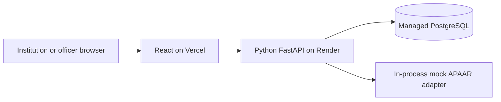

# 02 — Technical design

Implementation update: core code now exists. Native Windows with PowerShell and PostgreSQL is the local default; Docker Compose is optional. Node 22.12+ or Node 24 is supported. The first frontend uses custom CSS/native controls rather than Tailwind/shadcn. Tests use the current Starlette-compatible HTTPX2 client. See [Windows setup](08-windows-setup.md), [engineering controls](09-backend-engineering.md), and [execution evidence](05-progress-checklist.md). The tables below retain the original design where noted; actual dependency versions are pinned in lockfiles.

Remaining extension contracts are in [Document 11](11-feature-execution-plan.md). The implemented additions are summarised below. Audit/grant keys are required only when their optional features are enabled. Hosting gates remain open.

E0 implemented contract: `permissions.py` explicitly grants capabilities to supported roles. Institution scope is mandatory for an institution administrator; an officer has no institution binding and cannot edit core records. E5/E6 add separate interval-review/integrity-check capabilities without institution-write rights. Unknown/future roles and invalid role/scope combinations fail closed in HTTP dependencies and repositories. An absent institution ID never grants cross-institution access. E7 adds separately scoped student/verifier roles behind `CONSENT_ENABLED`; they never inherit core read access.

E1 implemented contract: `rule_packs` retains hashed JSON content, a validator version, and a stable pack ID. `upload_batches.rule_set_id` pins each batch; legacy batches receive `legacy-core-3fec502` without changing their reports. Authenticated core roles can read `/api/v1/rules` and `/api/v1/rules/{issue_code}` with an optional `rule_set_id`. Content/metadata mismatch fails safely; unsupported validator versions cannot commit. Hash checks detect inconsistent stored content, not official authority or an immutable database. The dashboard adds base/supernumerary and independent nationality-flag counts; none change basic intake rules.

E2 implemented contract: institution-only `/api/v1/resolution-cases` supports list/create and versioned detail/PATCH operations. Cases target exactly one staged row or enrolment; canonical work keys deduplicate repeated origins. `resolution_case_events` retains bounded changes and `resolution_case_origins` retains source rows. Foreign cases return 404; officers cannot manage cases. Assignees, when supplied by API, must be active staff in the same institution. No personal free-text notes are accepted.

E3 implemented contract: a case-scoped `correction-context` response supplies the owning editor's supported fields under no-store headers. `correction-previews` stores an encrypted, author-bound ten-minute proposal; `/api/v1/correction-proposals/{id}/apply` accepts its ID and expected case version, not replacement fields. Scope, target/case versions, rule execution, identity result, and programme/intake inputs are checked again under locks. Record/history/case/audit/lineage/result commit atomically. Replays return the original result. `correction_origins` links repaired source rows; their operational status becomes `SUPERSEDED_BY_CORRECTION`, excluding them from current held/unassignable work. The case then targets the canonical enrolment while retaining origin links.

New batches retain their original `summary`; a distinct `commit_summary` records commit-time recalculation. Existing older summaries remain as stored; this release cannot reconstruct a historical snapshot already overwritten by older code. `batch_rows.expected_enrolment_version` protects ordinary uploads from replaying stale corrections; legacy pending previews use -1 and require a new upload. Committed results remain repeatable.

Identity locks: operations lock programmes, then sorted private digest advisory locks (which cover absent/new people), then existing person/enrolment rows. Verified people are resolved before enrolment locks during commit, inline apply, and outage retry. Lifecycle edits use the same person-before-enrolment protocol. All locks live inside the mutation transaction.

E5 implemented contract: `overlap_reviews` uniquely identifies an ordered verified-enrolment pair. Inclusive recorded dates include historical and scheduled intersections; a sequential transfer has no overlap when the first end precedes the second start. Mutations reconcile affected people under their shared identity locks. Versioned `overlap_review_events` retain evidence/decisions; changed dates close or reopen a review. Officer-only `/api/v1/overlap-reviews` supports paginated read/detail and bounded decision PATCH. Only demo policy/reason codes are accepted. Institution responses expose a boolean own-record notice, never foreign institution/pair/person details; their audit output also omits the review ID. The explicit bounded `app.reconcile_intervals --demo` command backfills existing records without resetting data.

E6 implemented contract: optional `AUDIT_CHAIN_ENABLED=true` requires a separate retained base64 32-byte `AUDIT_HMAC_KEY` and `AUDIT_KEY_ID`. Audit events queue within the current transaction; a before-commit hook flushes business writes before locking the singleton `audit_chain_head`. The migration inserts genesis; metadata-only schemas bootstrap idempotently. A missing/reset head cannot restart an existing chain. Committed sequence numbers are allocated under the head lock, not a serial sequence. A signed legacy snapshot is captured at first activation; it does not prove original legacy authenticity. Officer-only `GET /api/v1/audit-events/verify` uses an independent repeatable-read snapshot, checks every HMAC/link/sequence and the head, and detects legacy edits or retained-head tail deletion. Once activated, mutations cannot silently downgrade to unsigned audit writing. Whole-database rollback and application/key compromise remain outside this protection.

E7 implemented contract: `CONSENT_ENABLED=true` requires an independent retained `GRANT_TOKEN_KEY` and `GRANT_KEY_ID`. The demo seed adds two adult students and two approved verifiers while preserving existing passwords/bindings. Random 256-bit request handles expire after 15 minutes and are consumed once. Bounded, idempotent requests expire after 24 hours; invalid handles receive an indistinguishable acknowledgement/submission shape without a student inbox entry. A per-verifier database advisory lock serialises a 10-request/minute bound.

Students explicitly approve a requested whitelist subset and 1–60 minute expiry, checking both the request and displayed record version. Grants bind person, enrolment/version, individual verifier/organisation, purpose, fields, expiry, key ID, and revocation. Only digests are stored; approval/reissue reveals the token once. Reissue invalidates the prior grant and requires the latest unchanged grant/request. Resolve locks programme/person/enrolment before request/grant rows, validates live state, and commits access/audit before disclosure. Failure records no successful access. Student/verifier screens use no browser storage; QR fragments are captured once, cleared before routing, and POSTed after login. `qrcode.react` is pinned to 4.2.0. Sensitive API responses are no-store/no-referrer; Vercel header configuration and a frontend referrer meta tag are supplied, with hosted behaviour still unverified.

Demo UI update: role-specific React routes use focused record, approval, access, and history components with shared scoped form controls. Student and verifier pages use a responsive navigation shell; officer overview/queue reuse core scopes. `GET /api/v1/me/verification-requests` accepts optional `PENDING|APPROVED|DENIED|EXPIRED` status filters; PENDING excludes expired requests, and totals remain person-scoped before pagination. No migration or new runtime dependency is introduced. The visible student card uses existing own-record fields and the workspace display name, with no new legal-name or official-credential claim. See [the interface guide](13-demo-interface.md).

## 1. Architecture baseline



The core has one API service and one database. The mock is an adapter in that service, not another deployment. No Redis, Celery, separate worker, vector database, or external LLM is required.

Use the current checkout. Cloud tasks are already isolated; do not create a Git worktree unless requested.

## 2. Stack and tools

| Layer | Selection | Notes |
|---|---|---|
| Python | 3.12 | Conservative baseline, not a claim about the latest release. Pin in `.python-version`. |
| Python packages | uv, `pyproject.toml`, `uv.lock` | Lock resolved versions; reproduce with `uv sync --frozen`. |
| HTTP API | FastAPI + Uvicorn | `/api/v1`; generated OpenAPI contract. |
| Input validation | Pydantic v2 + Python `csv` | CSV only in core. No pandas needed. |
| Database | PostgreSQL 16 | Use one managed provider, not two database services. |
| ORM/driver | SQLAlchemy 2 + psycopg 3 | Synchronous sessions and synchronous request handlers for core DB paths. |
| Migrations | Alembic | Run a controlled migration command before serving traffic. |
| Passwords | `pwdlib` with Argon2 support | Hash passwords; no plaintext stored credentials. |
| Tokens | PyJWT with a fixed allowed algorithm | Short-lived signed access tokens. |
| Field protection | `cryptography` AES-GCM + keyed HMAC lookup | Separate encryption and lookup keys. |
| Backend tests | pytest + HTTPX | Use a dedicated PostgreSQL test database for integration tests. |
| Frontend runtime | Node 22.12+ within Node 22, or Node 24 | Node 24.19.0 used for verified builds. |
| Web application | React + TypeScript + Vite | Exact compatible releases resolved in the first phase. |
| UI | Custom CSS + native controls + Lucide icons | Avoid an extra component-generation step in the core. |
| Routing/data | React Router + TanStack Query | Central request/error handling. |
| Charts | Recharts | Label counts, filters, and data freshness. |
| Frontend packages | npm + `package-lock.json` | `npm ci` for repeatable installs. |
| Frontend checks | TypeScript, ESLint, Vitest/Testing Library | Test meaningful state/error behaviour. |
| Browser smoke | Playwright | One deployed/core journey; avoid broad test expansion. |
| Local runtime | Native Windows PostgreSQL; optional Docker Compose | Python/Node run natively; WSL is not required. |
| Deployment | Vercel + Render + managed PostgreSQL | Human provisions accounts and approves costs. |

Dependencies are installed and locked. Core checks ran in the cloud machine. The Windows setup is cross-platform implementation guidance, not a claim that a Windows machine was tested. Hosting and optional components are unverified until their own checks run.

## 3. Proposed layout

```text
appar-id/
  docs/
  backend/
    pyproject.toml
    uv.lock
    .python-version
    alembic.ini
    migrations/
    app/
      main.py
      api/              # routes and dependencies
      schemas/          # requests and responses
      services/         # rules, upload, commit, reporting
      repositories/     # scoped queries
      models/
      adapters/         # mock registry; future real adapter
      security/         # auth, encryption, redaction
      fixtures/         # synthetic registry and accounts
    tests/
  frontend/
    package.json
    package-lock.json
    src/
      api/ auth/ components/ pages/ features/
    tests/
  scripts/              # seed, smoke, safe local demo reset
  compose.yaml
  .env.example          # names and harmless examples only
```

Keep business rules in services. Routes authenticate, parse inputs, and call services. Repositories apply explicit scope filters. The frontend does not decide permissions.

## 4. Data model

Use UUID identifiers, UTC timestamps, date columns for business dates, and `Asia/Kolkata` when deriving the business date. Store academic years as validated text, such as `2026-27`.

Read time through an injectable application-clock function. Tests fix that clock; hosted demo uses real time. Seed dates must place the intended active admissions on or before the current demo date. The active metric uses `ENROLLED` records with `start_date <= business_date` and no end date; do not advertise arbitrary historical reporting from current status alone.

| Table | Important data and constraints |
|---|---|
| `institutions` | Internal ID, unique internal demo reference, and name. Campus and synthetic AICTE identifiers belong to the explicitly simulated approval source. |
| `institution_approvals` | Unique institution/year, current decision/version, retained synthetic evidence snapshot, reviewer and review time. No automatic approval during migration/seed. |
| `institution_approval_events` | Unique approval/version, bounded decision/reason, retained evidence, actor and timestamp. Admission writers and decisions share an institution advisory lock before programme/person/enrolment locks. |
| `users` | Email unique, password hash, role, optional institution ID, active status. Institution role requires institution ID. |
| `programmes` | Institution, programme name, year, approved intake >= 0. Unique institution/name/year. |
| `persons` | Internal ID, unique keyed APAAR digest, encrypted APAAR/name/DOB, masked ID suffix. Only a successful mock identity match links a person. |
| `enrolments` | Institution, programme, student reference, year, optional person ID, identity status/reason, encrypted unresolved identity fields, dates, admission status, flags, version. |
| `upload_batches` | Institution, year, file hash, status, counts, timestamps, idempotency key, validation revision, committed result. |
| `batch_rows` | Batch, row number, encrypted submitted row, resolved programme/key, row status, issue codes, last validation result. |
| `enrolment_history` | Enrolment/version, non-sensitive snapshot, actor and timestamp. |
| `audit_events` | Actor, action, entity ID, request ID, timestamp, safe metadata. No raw identity details. |

Core canonical enrolment key: `(institution_id, programme_id, academic_year, student_ref)`. All uploads and reports use the same key. A separate uniqueness guard prevents a verified person appearing twice in the same programme/year. Keep cross-programme overlap as a review issue rather than an unconditional database ban.

Unresolved identities remain attached to enrolments. Do not populate `persons` merely because a submitted APAAR ID has a valid shape. Use explicit response schemas so encrypted blobs, HMAC values, password hashes, and internal registry payloads cannot escape through ORM serialization.

An identity correction must not silently merge two existing people. Hold an identity-reassignment conflict for review and preserve the current record. Encrypt staged rows; use the keyed digest only for exact lookup. Names or dates of birth alone are not identity proof.

E5 adds interval review/event tables. E7 adds `verifier_organisations`, `record_request_handles`, `verification_requests`, `consent_grants`, and `verification_accesses`. Nullable `users.person_id` and `users.verifier_org_id`, named foreign keys, a unique student/person binding, and an explicit role/scope check provide the student/verifier profile bindings without redundant one-to-one profile tables. No raw token table exists.

## 5. API contract

Errors use `{ "code": "...", "message": "...", "details": [] }`. Include a request ID in responses/logs. IDs are strings containing UUIDs. Dates use ISO format.

| Method and route under `/api/v1` | Access and purpose |
|---|---|
| `GET /health` | Minimal health status; no credentials, schema, or connection string. |
| `POST /auth/login` | Seeded user login; rate limited. |
| `GET /auth/me` | Current role and scope. |
| `GET, POST /programmes` | Institution list/create; officer read with explicit institution filter. |
| `PATCH /programmes/{id}` | Owning institution; audit an intake change. |
| `GET /templates/students.csv` | Authenticated template download. |
| `POST /batches` | Institution CSV upload; require `Idempotency-Key`. Returns completed dry run in core. |
| `GET /batches/{id}` | Owner or officer; summary and labelled count definitions. |
| `GET /batches/{id}/rows` | Scoped, paginated issues; filter by code/status. |
| `GET /batches/{id}/errors.csv` | Owner; safe correction report. |
| `POST /batches/{id}/commit` | Owner; `commit_valid` or `all_or_nothing`. |
| `POST /batches/{id}/discard` | Owner; cannot discard a committed batch. |
| `GET /enrolments` | Scoped records with filters/pagination. |
| `PATCH /enrolments/{id}` | Owner; validated status/date changes, expected version. Identity correction uses reviewed upload flow. |
| `POST /enrolments/recheck-identities` | Owner; bounded retry of registry-unavailable records only. |
| `GET /dashboard` | Role-scoped aggregates and definitions. |
| `GET /audit-events` | Institution-safe own activity or officer access. |

E7 consent routes use `POST /verification-requests`, own `/me/enrolments`, request inbox/submitted lists, approve/deny, grant list/revoke/reissue, and access history. Resolve is **`POST /verification/resolve`**, with the opaque token in a secret-typed body; no token-bearing GET route exists. Own-person scoping and bound-verifier live checks are enforced server-side. See Document 11 for the full contract.

## 6. CSV and validation contract

Header fields:

```text
student_ref,apaar_id,student_name,date_of_birth,programme,academic_year,admission_date,start_date,end_date,status,seat_type,supernumerary,nri,oci,foreign_national
```

All headers are required. `apaar_id`, `end_date`, and `seat_type` can be empty. Other values are required. Flags accept `Y` or `N`. Enrolment states are `ENROLLED`, `WITHDRAWN`, `TRANSFERRED`, and `COMPLETED`. Non-active states require an end date; dates must be in a valid order.

Initial limits: **500 rows, 2 MiB**, UTF-8 CSV. Enforce the byte limit while reading, not after loading unlimited content. Reject invalid headers, malformed encodings, duplicate canonical keys in a file, and excess limits with clear errors. Do not trust extension or content type alone. Spreadsheet formula cells in exports must be escaped.

Pipeline:

1. Parse and validate structure. Create field-specific errors.
2. Resolve institution-owned programme and year.
3. Normalise the assumed APAAR format. Call the mock adapter in bulk.
4. Map results to identity states and warnings.
5. Check duplicate verified identities and date consistency.
6. Preview the upsert effect, intake, held candidates, and issue counts.
7. Save staged results. Do not write main enrolments.

No external registry cache is needed in core. Exact name normalisation and DOB matching suffice for synthetic fixtures. Do not let fuzzy name similarity establish verified identity. A real adapter will require an agreed matching policy.

## 7. States and transactional behaviour

Batch states: `UPLOADED -> VALIDATING -> DRY_RUN_READY -> COMMITTED`; failure can set `FAILED`; a non-committed batch can become `DISCARDED`. Core synchronous processing returns the completed result; it has no background progress percentage.

Identity states: `VERIFIED`, `PENDING_CHECK`, `INVALID`, `MISSING`. Store the reason separately. Retry only `PENDING_CHECK` rows caused by registry unavailability; mismatch rows need correction/review.

Commit uses one database transaction for the bounded batch. Lock the batch and affected programme rows in stable ID order, recheck current records, and recompute intake against current database state. Database constraints defend against concurrent duplicates. Write enrolments, versions, history, audit event, and batch result atomically.

`commit_valid` saves rows without blocking errors and leaves errors held. `all_or_nothing` refuses if blocking errors exist. Identity-only problems are warnings and remain countable. Retrying a committed batch returns its original result without additional writes.

Scope an idempotency key to institution and operation. Same key + same payload returns the existing batch; same key + different payload returns `409`. The enrolment key also prevents duplicate records when the same file uses a new request key.

Use expected-version checks for direct edits. A stale edit returns `409`; the UI asks the user to reload. If a new conflict invalidates a preview, refuse commit with a clear refresh instruction; do not silently commit under old validation.

## 8. Security baseline

- Core roles: `institution_admin` and `officer`. Optional E7 roles: person-bound `student` and approved-organisation-bound `verifier`, with separate capabilities and core-route denial.
- Issue short-lived access tokens. Keep tokens in browser memory for core; page refresh requires login. Do not store persistent tokens in local storage. Use authenticated API requests, including CSV downloads.
- Validate signature, expiry, fixed algorithm, issuer, and audience. Recheck user active status. Use generic login errors and rate limits. Per-process limits are a single-instance demo control, not a distributed defence.
- Apply ownership checks to detail, list, edit, export, and batch actions. Return `404` for foreign institution objects.
- Mask APAAR IDs in ordinary views. Never expose a platform-wide student search to institution users.
- Encrypt identity fields and staged raw rows. Generate encryption, HMAC, and signing secrets outside source control; preserve keys across redeploys. Changed encryption keys without a migration make old data unreadable.
- Log codes and internal IDs, not names, DOB, tokens, uploaded rows, or unmasked APAAR IDs.
- Use HTTPS and exact CORS origins. CORS is not authorization.
- Core audit history has optional E6 HMAC integrity checks. It is not tamper-proof; external anchoring is unimplemented.
- Publish only synthetic demo data. Production retention, deletion, legal, and threat reviews remain separate work.

## 9. Runtime configuration

| Name | Location | Treatment |
|---|---|---|
| `DATABASE_URL` | Backend | Secret managed database URL; enforce provider-supported TLS verification. |
| `JWT_SECRET` | Backend | Secret; persistent, generated securely. |
| `JWT_ISSUER`, `JWT_AUDIENCE` | Backend | Non-secret fixed validation values. |
| `PII_KEY` | Backend | Secret AES-GCM key, 32 random bytes encoded for storage. |
| `HMAC_KEY` | Backend | Separate secret, 32 random bytes. |
| `ALLOWED_ORIGINS` | Backend | Exact deployed frontend origin plus local origin in local config only. |
| `REGISTRY_MODE` | Backend | `mock` for demo; real mode must fail closed until implemented. |
| `MOCK_REGISTRY_OUTAGE` | Backend/local fixture | Test switch; no unauthenticated web toggle. |
| `APAAR_ID_PATTERN` | Backend | Assumed 12-digit pattern; not an official confirmed contract. |
| `APP_TIMEZONE` | Backend | `Asia/Kolkata`. Store event timestamps in UTC. |
| `APP_ENV` | Backend | `local`, `test`, or `demo`; protect seed/reset commands. |
| `VITE_API_BASE_URL` | Frontend | Public backend URL with agreed API prefix. Never put secrets in `VITE_` variables. |

Only configure variables actually read by the implementation. The table is a design contract, not existing platform bindings.

## 10. Deployment and operational checks

Render: root directory `backend`; create the environment from the frozen Python lock; run `alembic upgrade head` as a controlled pre-deploy/release step; start Uvicorn on `0.0.0.0` and Render's `$PORT`. If the chosen plan lacks a release hook, document a manual migration before service activation. Never run competing migration jobs in each worker startup.

Vercel: root directory `frontend`; `npm ci` then `npm run build`; publish `dist`; configure SPA rewrites for nested routes. Set the public API URL before build. A URL change requires a frontend rebuild.

Database: choose one provider and a supported region. Verify connection limits and TLS configuration. Persist data only in PostgreSQL for core; do not depend on the API container filesystem. Use database reset/seed only in an explicitly designated demo database with an operator confirmation guard.

Reproducible commands to implement and verify:

```text
backend: uv sync --frozen
backend: uv run alembic upgrade head
backend: uv run python -m app.seed --demo
backend: uv run uvicorn app.main:app --host 0.0.0.0 --port <port>
backend: uv run pytest
frontend: npm ci
frontend: npm run typecheck
frontend: npm run lint
frontend: npm run test -- --run
frontend: npm run build
```

These are target interfaces; they have not been executed and must be created during implementation. Record verified commands in this document after they work.

After deployment, test login, upload, commit, correction, dashboard, ownership denial, direct navigation to a nested frontend route, and persistence after backend restart. Inspect the actual hosting plan for idle suspension, database expiry, connection caps, and cost before the presentation.

## 11. Capacity boundary

Keep mock bulk calls and API processing bounded. Run a 500-row timing test against the real chosen hosting plan. Record elapsed time and timeout behaviour. If it cannot complete reliably within the host's documented request limit, reduce the documented supported limit before the demo, or implement a persistent worker queue. Do not respond with “accepted” and leave work in an in-memory background task that can disappear on restart.

Real 50,000-row processing is a later persistent-job design, not a claim of this architecture.
