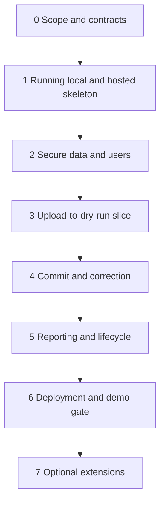

# 04 — Implementation phases

Current implementation note: the local core through Phase 5 now exists, and the local portion of Phase 6 has passing evidence. Start by inspecting the checklist; do not regenerate the application from Phase 1. Hosted deployment, native Windows execution, human review, and optional features remain pending.

For the newly discussed resolution/diff, rule-provenance/category, overlap, audit-chain, and consent/QR work, use [the extension execution plan](11-feature-execution-plan.md). Its E0–E8 order replaces the generic Phase 7 ordering for that iteration. E0–E3 and E5–E7 are now locally implemented and checked; the existing core and release checks still apply. Hosted E4/E8 and human review are incomplete. Use the [operator walkthrough](12-demo-walkthrough.md) for the delivered flow.

## 1. How to use this plan

Follow the dependency order. Finish a small working slice before expanding it. The two-day constraint means optional work is cut first; permission checks, truthful counts, and a runnable core are not optional.

Ownership labels:

- **AI:** AI can draft or implement the task and execute checks in an authorised environment.
- **HUMAN:** A person supplies a decision, account access, secure secret entry, legal/policy confirmation, or presentation judgement.
- **SHARED:** AI prepares the concrete result; a person reviews consequential choices and user-facing behaviour.

Humans need not hand-write code. AI must not invent credentials, authority, test results, policy decisions, or deployment status. Account and cost decisions remain human work; once authorised access exists, AI can perform supported deployment operations.

Start hosting-account setup in Phase 0. Keep the deployed skeleton working while later features are added. Do not wait until the final phase to discover CORS, database, build, or routing issues.

## Phase 0 — Fix scope and contracts

**Outcome:** One agreed definition of the core, data, and counts.

| Task | Owner | Output |
|---|---|---|
| Read source PDF and build pack; identify contradictions. | AI | Explicit decisions and open questions. |
| Confirm the official SIH problem statement and presentation requirements. | HUMAN | Source link or file; any scope corrections. |
| Adopt F01–F11 as the proposed core; rank NEXT features. | SHARED | Scope record in the checklist. |
| Confirm that only synthetic data will be used. | HUMAN | Demo-data decision. |
| Finalise CSV columns, issue codes, API routes, identity mapping, and intake definition. | AI | Updated technical/feature contracts. |
| Select one database provider; create Vercel/Render/database projects and approve plan costs. | HUMAN | Accounts/projects and secure access, not secrets in chat. |
| Read the OKF assessment; choose the document bundle now and runtime assistant later. | SHARED | No new runtime dependency on OKF tooling. |

**Exit gate:** No unresolved question prevents the core data path. The real-registry API is not a blocker because the demo explicitly uses a mock. Production policy questions stay recorded and block only production claims.

**First AI task:** Review contracts and produce the smallest schema/API task. Do not generate the entire application in one prompt.

## Phase 1 — Running skeleton and early hosting

**Dependencies:** Phase 0 technical baseline.

**AI tasks:**

1. Create backend/frontend folders and pinned tool versions.
2. Generate Python and npm lockfiles from compatible packages.
3. Add environment-name examples, typed settings, and missing-key startup errors.
4. Add local PostgreSQL Compose and a disposable test-database path.
5. Add a minimal API, `/health`, frontend route shell, and central API client.
6. Add initial migrations and deploy configuration. A database-ready health check must perform a real database check.
7. Build and start locally. Deploy the skeleton using authorised project access; inspect build/start logs.

**Human tasks:** Connect the repository to hosting, approve requested service plans, enter secrets securely, and provide supported account authorisation where unavailable to AI. These do not require waiting to build local code.

**Shared review:** Open the hosted application and confirm frontend/API connectivity and clear environment labels.

**Exit gate:** Clean install succeeds; frontend builds; API and database communicate locally and on hosting; nested frontend route resolves. Record exact commands and results. No claim of completed features yet.

## Phase 2 — Secure data, users, and programme setup

**Dependencies:** Working database and API.

**AI tasks:**

1. Implement institution, user, programme, person, enrolment, staging, history, and audit schemas.
2. Add encryption helpers and fixed-algorithm token validation.
3. Implement seeded accounts, sign-in, own-institution scope, and officer read scope.
4. Implement programme list/create/intake edit, with audited changes.
5. Add explicit response models and safe logging.
6. Add meaningful negative tests: foreign detail/list/export access, expired tokens, inactive users, encryption round-trip and ciphertext tampering.
7. Create the minimal login/programme screens against actual API responses.

**Human tasks:** Review what each role should see and decide how demo account credentials will be shared. Enter persistent cryptographic keys securely.

**Exit gate:** F01/F02 behaviour works end to end. Tests prove isolation and no secret-field leakage. Seed twice is safe. Do not build the remaining UI on an unscoped generic CRUD API.

## Phase 3 — One upload-to-dry-run slice

**Dependencies:** Institution scoping, programme lookup, staging tables.

**AI tasks:**

1. Add CSV template and bounded parser.
2. Implement the mock registry adapter and six-row identity fixture.
3. Define the issue registry and pure structural/identity validation functions.
4. Add upload idempotency and encrypted staging.
5. Calculate the projected upsert effect without changing main enrolments.
6. Build the upload and dry-run screens with loading, empty, failure, and warning states.
7. Add issue filtering and authenticated correction CSV download.
8. Test malformed files, invalid programme/date, missing/invalid IDs, mismatch, and outage.

**Human tasks:** Try the flow as college staff. Check whether messages make the correction clear. Review the mock disclosure.

**Exit gate:** F03–F05 run through the real UI/API. The identity fixture matches the expected states. Database assertions prove zero main-record changes before commit. No fake dashboard values.

**Cut discipline:** Do not add XLSX, column auto-mapping, a live registry, or a job queue in this phase.

## Phase 4 — Commit, correction, and concurrency

**Dependencies:** Stable dry-run schema and rules.

**AI tasks:**

1. Implement row acceptance: structural errors block; identity-only problems warn.
2. Implement atomic `commit_valid` and `all_or_nothing` operations.
3. Lock affected batch/programmes; revalidate against current database state.
4. Implement canonical-key upsert, unchanged-row no-op, versioned changes, and audit/history.
5. Add uniqueness protections and safe identity-link conflict handling.
6. Test repeat commit, repeated upload, changed-key payload conflict, corrected upsert, rollback, and concurrent attempts.
7. Implement bounded identity recheck for registry-unavailable enrolments with the same uniqueness/audit rules.
8. Connect commit and correction actions in the UI.

**Human tasks:** Review which data can be committed with a warning and which must remain held. Try a correction upload and verify the explanation is understandable.

**Exit gate:** F06 and F09 pass. Repeating operations does not change totals. Failed commits roll back fully. A mock outage/recovery works without hand-editing the database.

## Phase 5 — Useful records, dashboard, and history

**Dependencies:** Committed records and safe correction path.

**AI tasks:**

1. Add scoped enrolment list/detail and validated lifecycle edits.
2. Calculate active intake and identity-state totals server-side.
3. Add deduplicated held-candidate and unassignable-row reporting.
4. Add officer/institution dashboards with definitions and filters.
5. Add record history and scoped audit views.
6. Create and test the 65-admission fixture, correction fixtures, and withdrawal scenario.
7. Inspect real API responses and browser views for personal-data leakage.

**Human tasks:** Confirm the charts tell a clear story. Review count labels and the distinction between a warning and a compliance finding. Choose the presentation examples.

**Exit gate:** F07/F08/F10 work. A 60-seat programme with 65 active admissions, including 5 missing IDs, reports 65/5/5 correctly. Withdrawal reduces active intake without deleting history.

## Phase 6 — Release and demo gate

**Dependencies:** F01–F10 functional and checked.

**AI tasks:**

1. Run backend tests, frontend checks/build, and the core browser smoke.
2. Verify migrations/seed against a clean disposable database.
3. Deploy the complete app; verify exact CORS origins, HTTPS, API URL, database TLS, and SPA routes.
4. Measure the maximum advertised CSV case on the selected hosting plan; record results.
5. Restart the API and verify persistence plus decryption with retained keys.
6. Run cross-institution negative checks on the deployed app using synthetic users.
7. Prepare a short demo script, exact fixture list, reset instructions, and known-limitations note.
8. Update the checklist with evidence and actual deployed capabilities.

**Human tasks:** Approve any hosting cost change, review published demo-account exposure, rehearse the story, confirm the mock label is visible, and record a backup walkthrough. Submit/present through the official process.

**Exit gate:** F11 and the release checklist pass. An implementer can start the app from the documented commands. The deployed journey works, not merely the local version. Any remaining failure has an explicit owner and effect on claims.

**If capacity fails:** Reduce the supported limit truthfully or build durable processing. Do not hide timeouts or claim untested scale.

## Phase 7 — Optional extensions in priority order

Start only after Phase 6 gates pass or the team explicitly trades scope with documented consequences.

1. **F12:** Student-controlled verification. Implement consent and negative tests before the QR view. Human confirms requested fields and demo wording.
2. **F13:** Explainable overlapping-enrolment review. Human confirms policy assumptions; AI implements deterministic detection and review history.
3. **F14:** Source-linked help using approved knowledge. Start with deterministic search. Add an LLM only with approved credentials, cost limits, and privacy checks.

Do not leave half-built optional routes accessible. F15/F16 require a separately planned iteration.

## 2. Task sizing for AI implementation

Use one bounded task with a clear completion condition. Suggested sequence inside a feature: migration/model → service and meaningful tests → route and scope tests → UI against API → smoke and documentation.

Before each task, read the relevant feature, contract, and checklist. After each task, show changed files, executed checks, results, and remaining issues. Update documentation if behaviour changed. A generated patch is not a passing feature.

The plan does not require parallel agents. If the team later chooses parallel work, isolate ownership and agree API contracts first; shared migrations and central auth/rule files require a single coordinator.

## 3. Stop conditions

Stop optional expansion when core tests fail, deployment is unstable, or no rehearsal has occurred. Stop real-data work until access and policy prerequisites exist. Missing human input must not stop independent local implementation unless it changes the contract being built.
