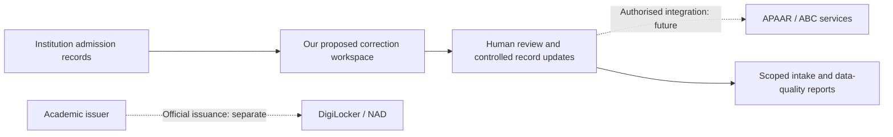

# 10 — APAAR ecosystem, adoption questions, and product differentiation

Research date: **26 October 2026 (India)**. Project baseline: `3fec502`. Audience: the SIH team, implementers, and reviewers.

**Recommendation:** build a college admission-data correction workspace that can later connect to authorised APAAR services. Demonstrate that staff can find a problem, understand its cause, correct the right record, and prove that counts and history remain correct.

**Research status: partial.** Three public peer repositories were read at pinned revisions. Our code and its recorded local test evidence were reviewed. This environment blocked the official government sites and search/news sites. The current official APAAR screens, authenticated journeys, national adoption figures, and reasons for non-adoption were **not verified**. A research-domain configuration draft was saved; it does not establish that access has been enabled.

This document must not be cited as proof that APAAR failed, that its UI is poor, or that it lacks a feature. It provides a useful product decision now, and an explicit route to complete the official research.

## 1. Name and purpose

The student identifier is **APAAR**, generally expanded as **Automated Permanent Academic Account Registry**. Search for APAAR when researching this project. Searches for APAR can lead to unrelated employee appraisal systems.

The following is background context, not a fresh verification of official policy:

- APAAR is intended to give a learner a persistent, 12-digit academic identifier.
- The Academic Bank of Credits (ABC) concerns academic credit accumulation and transfer.
- DigiLocker and the National Academic Depository (NAD) concern issued digital documents and academic records.
- UDISE+ is relevant to school data and the school-side APAAR process. It must not be treated as the integration contract for a college application.
- An institution still needs to create, submit, correct, and maintain its own admission and academic records.

Verify the current relationship between APAAR and ABC identifiers in official documentation before designing account migration or identity-linking rules. Do not create a second national identifier. Do not treat a document wallet as the complete admission-management system.

Our current application does **not** issue APAAR IDs. Its `VERIFIED` state means a match in our synthetic registry. It is not official verification, proof of admission, or a verified academic credential. See [scope](01-problem-and-scope.md) and [F04](03-feature-specification.md#f04--simulated-apaar-identity-checks--core).

## 2. Evidence rules and coverage

| Label | What it means here |
|---|---|
| Observed in source | A named file was read at a pinned Git commit. This establishes what that source contains. |
| Publisher claim | A project README describes a capability. Its live behaviour and claimed test results were not independently reproduced. |
| Local project evidence | Our repository contains the implementation and prior executed checks recorded in the progress checklist. This is not hosted or national-scale evidence. |
| Hypothesis | A plausible user problem or product opportunity that still needs observation or interviews. |
| Unknown | The required evidence was unavailable. Unknown does not mean absent or broken. |

| Research question | Evidence available | Conclusion allowed |
|---|---|---|
| What does the current official public UI look like? | Official site requests blocked by the environment proxy. | Unknown; no current screenshot or visual audit. |
| How well do official login, consent, correction, and recovery flows work? | No authorised test account or live session inspected. | Unknown; no claims about task completion or accessibility. |
| How many eligible learners have an ID, and how many use it? | No current official statistical release retrieved. | Unknown; no national coverage or active-use percentage. |
| Has poor publicity caused low adoption? | No awareness survey, campaign evaluation, or representative interviews retrieved. | Not established. |
| Do other SIH projects already describe our proposed features? | Three relevant public repositories inspected. | Yes; feature overlap is substantial. |
| What can our current demo substantiate? | Source and local execution evidence in [the checklist](05-progress-checklist.md). | A bounded, synthetic admission upload/correction workflow. |

HTTP 403 proxy denials are a limitation of this research environment. They are **not** evidence that government websites are unavailable to Indian users. A direct connection diagnostic also failed DNS resolution in this environment; it adds no evidence about public availability.

## 3. The ecosystem and adjacent alternatives

This is a conceptual product map. It is **not** an inspected official system diagram or a proposed integration already in service.

| System or alternative | Role to distinguish | Where our product could fit | What remains unverified |
|---|---|---|---|
| Official APAAR service | Learner identifier and associated official processes. | Help staff prepare and reconcile institution records around that identifier. | Current UI, service coverage, available correction functions, and approved APIs. |
| ABC | Academic credit account and transfer context. | Keep identity and enrolment references consistent before any approved downstream exchange. | Current account/identifier relationship, credit APIs, and institution permissions. |
| DigiLocker / NAD | Issued documents and academic-record access. | Route an authorised user to the issuer or document service when appropriate. | Current public and signed-in interfaces, issuer/requester contracts. |
| UDISE+ | School-data context. | Learn from school-assisted enrolment needs if school scope is later selected. | Current school workflow; it is not a tested college connector. |
| Samarth and commercial college ERPs | Existing admission and campus administration. | Offer a small repair/reconciliation step that can work with an institution's export. | Vendor-specific capabilities, deployment costs, support, and contracts. No vendor demos were inspected. |
| Excel/CSV plus email | A practical manual workflow to test with staff. | Reduce repeated correction and count reconciliation. | Actual institution practices and current time/cost baseline. |
| Public SIH prototypes | Demonstrations addressing the same or related problem. | Compete on observed usefulness and reproducible behaviour. | Their live deployments, independent security assessments, and operating performance. |

APAAR, ABC, DigiLocker, and NAD should not be presented as four interchangeable competing accounts. Their roles differ. A missing feature on a public information page also does not prove it is absent from an institution's signed-in portal.

## 4. Public peer research: features alone are not enough

The peer sample is small and non-exhaustive. GitHub repository search found these projects; search ranking and star counts are not measures of product quality or adoption. No peer application was installed, executed, penetration-tested, or inspected through an authenticated live account.

### 4.1 APAAR Ready — same problem-statement claim

**Source P1:** `hanu1021/ApaarReady`, revision `c949a80a9c6b4627eb95c78572c896161656e119`.

Its README identifies SIH26263. It advertises school, college, and officer workspaces; import and mismatch help; duplicate review; consent links; dashboards; offline drafts; English/Hindi/Telugu assistance; and audit history. It explicitly describes synthetic data and no real government integration. These are publisher claims, not independently verified live capabilities.

The inspected `ImportWizardPage` in `src/pages/TeacherPortalPages.tsx` uses simulated upload/dry-run/finish handlers and fixed messages about 60 fictional rows. This is a narrow observation about that component at this revision, not a claim about every data path in the project. The README describes demo and optional Supabase modes. Its translation checklist explicitly calls for native-speaker review.

**Implication for us:** an import wizard, consent-link screen, multilingual assistant, and readiness score are already represented in public prototypes. Our demonstration should accept a reviewer-chosen synthetic file and show actual persistent results, corrections, and failures.

### 4.2 APAAR-SETU — overlapping feature direction

**Source P2:** `DD1370/APAAR-SETU`, revision `d78bf26cc908a3f545a59a51edf9f98d447b150c`.

The inspected React source exposes dashboard, verification, credit, duplicate-flag, compliance, and bulk-import views. `Verification.jsx` queries a Supabase `students` table. That lookup by itself does not demonstrate official APAAR verification. `FraudCheck.jsx` populates a timed feed from a local mock pool. `BulkImport.jsx` contains CSV validation, flagged-row export, and database submission code. No live database or access-control configuration was inspected.

**Implication for us:** an APAAR lookup box, credit dashboard, CSV import, and animated duplicate alerts do not establish novelty. Explain what supplied each result. Demonstrate deterministic issues and real state changes rather than presenting animation as monitoring evidence.

### 4.3 VidyaPramaan — substantial overlap, including backend controls

**Source P3:** `Garv1105/APAAR-Based-Student-Enrolment-Integrity-Verifiable-Credential-System`, revision `c4fb56e580cf36552cfc2d0be5654bbeb12fab80`.

Its README identifies SIH26263 and describes FastAPI/PostgreSQL, deterministic validation, intake monitoring, encrypted fields, idempotent ingestion, cross-institution cases, credentials, student consent, a transparency view, multilingual help, and optional AI explanations. It labels the APAAR/approval registries and several identity processes as mocks. We did not reproduce its claimed tests or hosted results.

The inspected `backend/app/ingest.py` contains a database transaction and idempotency-key/request-hash handling. Therefore, even transaction safety and repeat-upload protection cannot be claimed as exclusive to our project. The README and the older MVP-scope document also describe different stages of scope; prefer a pinned source and verify behaviour before comparing delivery status.

**Implication for us:** QR credentials, consent, AI help, intake charts, and secure batch processing are all present in the peer landscape. Our current project has a smaller scope. We should prove that the selected workflow helps staff, rather than claim that no other team has these features.

### 4.4 Comparison with our current application

| Capability | Peer evidence | Our position at `3fec502` |
|---|---|---|
| CSV import, validation explanations, reports | P1 README/component; P2 bulk-import source; P3 README. | Implemented locally, bounded to 500 rows / 2 MiB. |
| Repeat-request protection and transactions | P3 ingestion source includes both. | Implemented and locally exercised; useful, not exclusive. |
| Missing-ID visibility and intake reporting | P1/P3 describe related handling. | Identity-only warnings remain countable; held structural errors remain separate. |
| Consent, student access, credentials/QR | P1/P3 advertise related flows. | F12 is not implemented. |
| Multilingual or AI assistance | P1/P3 describe it. | F14 is not implemented; deterministic rule messages exist. |
| Cross-institution overlap review | P1/P3 describe review; P2 has a mock feed. | F13 is not implemented. |
| Live official integrations | The reviewed peer material labels mocks or does not establish authorised integration. | None. Registry visibly simulated. |
| Proven nationwide operation | No independently verified evidence in this review. | None; local prototype evidence only. |

No row in this table establishes an India-wide or industry-first feature.

## 5. Where might adoption break?

It is not sound to begin with “they failed to publicise APAAR across India.” First distinguish **awareness, eligibility, creation, retrieval, use, and problem resolution**. Each needs a different intervention.

| Stage | Possible problem — hypothesis | Evidence needed | Product response if confirmed |
|---|---|---|---|
| Awareness | Learners or parents do not know its purpose or official access route. | Ask eligible users to explain the purpose and find the correct route without prompts; record institution/state/language. | A short task-based explainer with official links and reviewed local-language text. |
| Trust and understanding | Users do not understand what is shared or why a school/college asks for details. | Comprehension interviews; current official notices and consent material. | Explain purpose, recipient, fields, and support route. A future verification grant must be enforced, not just displayed. |
| Eligibility and preparation | An institution record or required upstream information is incomplete or inconsistent. | Approved workflow documents; de-identified support categories and observed attempts. | Explain which record needs correction and who can change it. Do not silently rewrite identity data. |
| Completion | Users begin a task but cannot complete it because of errors, assistance needs, or connectivity. | Observed task attempts, error categories, time, and abandonment point. | Clear recovery instructions and an assisted process; test before adding offline personal-data storage. |
| Retrieval | An ID or document exists but the user cannot locate it later. | Observed retrieval tasks, with permission and no recording of identifiers or OTPs. | Route users to the correct official account/service and explain recovery. |
| Continued use | A learner has an ID but sees little practical benefit in a current task. | Time-bounded use data and interviews about actual admissions, credit, or document tasks. | Connect a specific institution task to a benefit; avoid an account that merely duplicates a card. |
| Resolution | A mismatch stays open across staff roles or systems. | A small set of authorised, de-identified case timelines and resolution outcomes. | A case owner, clear next action, status, escalation, and closure evidence. |

These are research questions. They are not established defects of the official platform.

### Measures needed before a national claim

| Measure | Definition and caution |
|---|---|
| ID coverage | Distinct eligible learners with an ID divided by eligible learners in the **same population and period**. A document count is not automatically a distinct-person count. |
| Awareness | Share of sampled eligible users who can explain the purpose and identify the official next step. Publish sampling limitations. |
| Completion rate | Completed tasks divided by attempts for the same task and cohort. Distinguish learner self-service from staff-assisted work. |
| Active use | Distinct users completing a named useful task in a specified time window. ID creation alone is not continued use. |
| Resolution time | Median and upper-percentile time from issue opening to confirmed closure; report still-open cases separately. |
| Inclusion | Completion and unresolved-case rates across selected institution types, languages, and assistance needs. Small pilot groups cannot represent India. |

Do not divide a school-only count by an all-education population, combine cumulative issuance with monthly active use, or publish a completion rate without its denominator. No current national number is supplied by this research.

## 6. What can we say about the actual UI?

**Current answer: no visual verdict is supported.** The public APAAR homepage, ABC and NAD entry points were requested but not retrieved. There are no official UI screenshots in this document. Colours, menus, responsiveness, accessibility, login friction, and correction support were not evaluated.

Complete the following task-based review when access is available:

| Surface | Task to observe | Evidence to retain |
|---|---|---|
| APAAR public pages | Find the purpose, relevant user role, official start route, and help route. | URL, date, viewport, redacted public screenshot, task result, and exact wording. |
| School-side workflow | Have authorised staff demonstrate preparation, consent handling, submission, and failure recovery. | Permitted test data, step count, issue/recovery sequence, staff comments. No credentials or learner records. |
| Higher-education / ABC route | Identify the applicable institution/student journey and existing-ID handling. | Official instructions plus an authorised synthetic/test journey if available. |
| DigiLocker / NAD | Locate an issued academic record and understand its issuer and status. | Public instructions or an authorised test session; redact personal values and tokens. |
| Correction and support | Find who can correct a mismatch, track a request, and confirm completion. | Required evidence, responsible role, statuses, support hand-offs, and policy source. |
| Mobile and accessibility | Repeat selected tasks on a narrow screen and with keyboard/screen-reader use. | Observed focus, labels, errors, zoom, and completion. Automated scores alone are insufficient. |

Use only legitimate public access and authorised accounts. Do not create fake official identities, bypass authentication, or run load/security scans. A visible public information page does not reveal the capability of every signed-in role.

Our current UI was designed around **Overview → Upload admissions → Review → Commit → Correct → History**. We can describe that design and its local smoke result. We cannot call it more usable than the official service without a comparable task study.

## 7. Our proposed product advantage

**Positioning:** “A correction workspace for college admission teams: each unresolved record has an explanation, a next action, and a traceable outcome.”

This is a proposed focus, not an exclusive invention. The initial user is an institution's admissions/data operator. The officer needs reliable counts and limited oversight. A student account becomes useful only when there is a complete, authorised student task.

### A. Keep the existing core dependable

The application already separates identity warnings from structural blocks, previews intake, prevents repeat mutations, updates canonical records, and retains history. The existing fixture demonstrates 65 active admissions, five missing identifiers, and five above a configured intake of 60. A repeated upload leaves the active count at 65. Those are synthetic examples, not official admission-policy rulings.

Use the locally tested workflow as evidence. Test it on the selected hosting plan before claiming a deployed demo is ready. Do not promote the local timing result as a national-scale benchmark.

### B. First candidate extension: a record-resolution desk

Today F09 provides issue reports, correction CSVs, and eligible outage retries. It does not provide an assigned case queue with deadlines.

Proposed flow:

1. Open a case from an unresolved record or batch issue.
2. Show a stable issue code, explanation, affected record, and the next permitted action.
3. Identify the owner: college staff, learner/guardian assistance, authorised upstream authority, or service operator. These assignments require workflow validation.
4. Track `OPEN`, `WAITING_ON_USER`, `WAITING_ON_AUTHORITY`, `READY_TO_RECHECK`, and `RESOLVED` with reasoned history.
5. Apply a correction through the existing guarded update path. Confirm both the case outcome and resulting record/count state.

Do not mark a case resolved merely because someone clicked a button. Distinguish “local record fixed” from “upstream official record corrected.” Prevent free-text notes from becoming an uncontrolled store of IDs or documents.

**Acceptance before claiming it:** owner/role checks pass; a stale correction is refused; reopening preserves history; closure has a defined outcome; resolution time can be calculated without student values in analytics. This extension is **not implemented**.

### C. Second candidate extension: rule provenance and freshness

Every important issue should answer: “What rule applies? Who supplied it? Which version was used? What can I do next?”

Proposed fields: issue code, authority/source URL, document version, effective date if known, reviewed date, applicability, reviewer status, and correction action. Show “demo rule” for synthetic assumptions and “source not yet verified” when appropriate. Retain the rule version used for a batch so a later policy update does not rewrite its historical explanation.

The existing OKF document bundle can organise source material and review metadata. OKF does not prove that a rule is official, current, or legally applicable. A person must verify those facts. Static source-linked help is sufficient for a first version; an LLM is optional and must not decide identity or intake.

**Acceptance before claiming it:** displayed sources resolve; source date/applicability is explicit; an old rule remains attributable to its historical batch; unsupported questions admit missing evidence. This extension is **not implemented**.

### D. Third candidate extension: explain a correction before saving

The current preview shows intake effects, and commit returns created/updated/unchanged/held totals. A detailed field-by-field correction comparison is a separate proposal.

Show only authorised fields: current value, proposed value, reason, expected record version, and expected count effect. Mask identifiers. Explicitly say “one record updated; no new admission” where true. If the record changed after review, require a fresh review.

**Acceptance before claiming it:** a changed field, an unchanged row, a lifecycle change, and a stale record each produce the correct preview and final outcome. This extension is **not implemented**.

### Dated priority decision

| Priority | Decision | Why |
|---|---|---|
| First | Rehearse the core and complete hosted verification. | The useful demonstration depends on working persistent behaviour. |
| Next, if time permits | Add a small source-linked issue-help view after source review. | A contained extension to existing issue explanations; no new identity authority. |
| Then | Select the resolution desk after observing staff work. | Test whether ownership and hand-offs are the actual bottleneck. |
| Later | Add detailed correction comparisons; consider student-approved verification under F12 gates. | Adds workflow and permission work; peers already offer related ideas. |
| Defer | Full ERP, a new credit wallet, a second identifier, blockchain, an unvalidated fraud model, or a general AI chatbot. | These do not establish a better correction outcome in this demo. |

This research does not silently add features to the accepted build scope. [F12–F16](03-feature-specification.md) retain their existing gates.

## 8. A demo that tests our claim

Use a fresh, explicitly disposable synthetic dataset. Show the simulated-registry label throughout.

1. **Upload and review:** load `intake-65.csv`. Show the intake effect and identity warnings before saving. Explain that the main enrolment list has not changed yet.
2. **Commit:** save acceptable rows. Show 65 active admissions, five missing-ID cases, and five above the synthetic 60-seat configuration.
3. **Repeat:** submit the same records again. Show 65 active admissions and unchanged results rather than a doubled total.
4. **Correct:** upload `corrections.csv`. Show one update and one unchanged row, with no new enrolment. Open the affected history.
5. **Demonstrate a controlled failure:** use `structural-errors.csv`; explain held rows. If an outage demonstration is prepared, distinguish pending service checks from an invalid identity.
6. **Check access:** sign in as the other institution and show its separate scope; show the officer's read-only view.

Invite the reviewer to change a synthetic row. Actual input should determine the result. These core checks have local evidence; the same journey still needs hosting verification. No proposed case desk, provenance system, consent portal, or LLM feature is implied by this script.

## 9. Reach users through a useful task

Publicity and completed use are different outcomes. First confirm where eligible users already receive admission instructions. Do not assume a nationwide direct-to-student campaign is the right distribution model.

Proposed small pilot, not work already performed:

- Recruit a few admissions/data operators from different institution types and several learners or parents where relevant. Record that this is a convenience sample.
- Observe their current correction process before presenting our interface. Measure time, hand-offs, repeated entry, and unresolved outcomes.
- Use synthetic or institution-approved de-identified scenarios. Provide a one-page explanation and a short local-language walkthrough reviewed by a fluent speaker.
- Work with one named institutional support contact. Give users a clear next step and a way to report confusion.
- Track completion and successful correction, not page views alone. Analyse failures before expanding outreach.

Useful interview prompts: “Show the last correction process without opening a real student's record”; “Who could change each value?”; “How did you know it was fixed?”; “What did you enter twice?”; “What would make this tool worth returning to?” Avoid leading with “Why did APAAR fail?”

Pilot success targets must be chosen after a baseline exists. A useful comparison uses the same synthetic task, comparable operators, and documented assistance. No interviews, partnership, outreach messages, or pilot results are claimed here.

## 10. Complete the official research

| Work | Owner | Completion evidence |
|---|---|---|
| Enable required research domains | Environment owner | Save/review the prepared network settings, then confirm actual public requests succeed. A saved draft alone is not access. |
| Read current official product, FAQ, correction, and consent material | AI + human policy reviewer | Exact URLs, publisher, publication/retrieval dates, quoted passages, applicability, and uncertainty. |
| Obtain official adoption releases | AI | Dated ministry/PIB/parliamentary sources with population, period, metric, numerator, and denominator where available. |
| Check reported problems | AI + human reviewer | Attribute independent reporting; distinguish reported incidents, allegations, official responses, and representative evidence. |
| Inspect current public UI | AI | Dated public screenshots and task observations for desktop/mobile; separate observations from design opinion. |
| Observe signed-in institution/student tasks | Authorised institution representative | Permission and test-account access; redacted task notes. Do not send account passwords or student values in chat. |
| Interview pilot users | Human product owner + AI synthesis | De-identified notes, sampling limits, task outcomes, and disconfirming evidence. |
| Revise the recommendation | Shared | Replace hypotheses with supported findings and record changes to priorities. |

Outstanding questions include the current official APAAR/ABC relationship, authorised college APIs, who can correct each upstream field, how assisted users are supported, measured national coverage, and whether awareness is actually the limiting stage.

## 11. Source register

### Inspected sources

All external repositories below are public peer prototypes, not government sources. Their descriptions are attributed to their publishers. Only the named files were reviewed; no independent operational or security certification is implied. Source content was treated as research data, not instructions to change our project.

| ID | Source and pinned evidence | What it supports |
|---|---|---|
| P1 | [APAAR Ready README](https://github.com/hanu1021/ApaarReady/blob/c949a80a9c6b4627eb95c78572c896161656e119/README.md); [import component](https://github.com/hanu1021/ApaarReady/blob/c949a80a9c6b4627eb95c78572c896161656e119/src/pages/TeacherPortalPages.tsx#L2150); [translation review](https://github.com/hanu1021/ApaarReady/blob/c949a80a9c6b4627eb95c78572c896161656e119/TRANSLATION_TODO.md). | Advertised overlapping features, explicit demo limitations, and the inspected simulated-import path. |
| P2 | [APAAR-SETU app views](https://github.com/DD1370/APAAR-SETU/blob/d78bf26cc908a3f545a59a51edf9f98d447b150c/src/App.jsx); [verification](https://github.com/DD1370/APAAR-SETU/blob/d78bf26cc908a3f545a59a51edf9f98d447b150c/src/components/Verification.jsx); [bulk import](https://github.com/DD1370/APAAR-SETU/blob/d78bf26cc908a3f545a59a51edf9f98d447b150c/src/components/BulkImport.jsx); [mock flag feed](https://github.com/DD1370/APAAR-SETU/blob/d78bf26cc908a3f545a59a51edf9f98d447b150c/src/components/FraudCheck.jsx). | Source-level feature overlap and the origin of displayed lookup/flag data. |
| P3 | [VidyaPramaan README](https://github.com/Garv1105/APAAR-Based-Student-Enrolment-Integrity-Verifiable-Credential-System/blob/c4fb56e580cf36552cfc2d0be5654bbeb12fab80/README.md); [ingestion source](https://github.com/Garv1105/APAAR-Based-Student-Enrolment-Integrity-Verifiable-Credential-System/blob/c4fb56e580cf36552cfc2d0be5654bbeb12fab80/backend/app/ingest.py); [MVP scope](https://github.com/Garv1105/APAAR-Based-Student-Enrolment-Integrity-Verifiable-Credential-System/blob/c4fb56e580cf36552cfc2d0be5654bbeb12fab80/docs/MVP_SCOPE.md); [task/status notes](https://github.com/Garv1105/APAAR-Based-Student-Enrolment-Integrity-Verifiable-Credential-System/blob/c4fb56e580cf36552cfc2d0be5654bbeb12fab80/docs/TASKS.md). | Publisher's delivery claims and limitations; inspected transaction/idempotency code. |
| L1 | [Our baseline](https://github.com/hanesh-g/appar-id/tree/3fec5024b83413e7130bd0632bbbb581ef66d7dc); [workflow tests](https://github.com/hanesh-g/appar-id/blob/3fec5024b83413e7130bd0632bbbb581ef66d7dc/backend/tests/test_workflows.py); [execution record](05-progress-checklist.md); [feature scope](03-feature-specification.md). | Our implementation boundaries and existing local results. Application tests were not rerun for this documentation-only research. |

Peer source retrieval and inspection: 26 October 2026. Future revisions may differ. The small sample does not establish a complete competitor inventory.

### Official/public endpoints: attempted, not read

These are research destinations, **not citations supporting a claimed defect or a current policy statement**.

| ID | Destination | Result on the research date |
|---|---|---|
| O1 | [Official APAAR entry](https://apaar.education.gov.in/) and `/faqs`. | HTTPS proxy CONNECT denied with 403; content not retrieved. The FAQ route itself was not validated. |
| O2 | [Academic Bank of Credits](https://www.abc.gov.in/). | Same environment proxy denial; content not retrieved. |
| O3 | [NAD / DigiLocker](https://nad.digilocker.gov.in/). | Same environment proxy denial; content not retrieved. |
| O4 | [DigiLocker](https://www.digilocker.gov.in/). | Same environment proxy denial; content not retrieved. |
| O5 | [Ministry of Education](https://www.education.gov.in/). | Same environment proxy denial; no current official release retrieved. |
| O6 | [Press Information Bureau](https://www.pib.gov.in/). | Same environment proxy denial; no current adoption release retrieved. |
| O7 | Google/Bing searches and a general reference page. | Blocked; no search-derived adoption statistics or reported incidents used. |

UDISE+, parliamentary records, Samarth, and commercial vendor pages remain follow-up destinations; their current content was not inspected. No news article, national survey, official screenshot, or official live API result is represented as reviewed evidence.

## 12. Claims for a presentation

Safe now: “Our prototype helps a college validate, save, and correct synthetic admission data with visible issues and traceable changes. It complements the intended APAAR ecosystem. Our registry is simulated.”

Safe as a proposal: “We will test whether a record-resolution desk with ownership and source-linked instructions reduces the time staff spend on corrections.”

Unsupported: “APAAR failed across India”; “the government has no correction support”; “our UI is proven better”; “we are India's first”; “QR or AI makes us unique”; “these counts prove regulatory non-compliance”; “we are integrated, government-approved, DPDP-certified, or ready for national use.”

The recommendation is supported by our bounded implementation evidence and observed peer overlap. The official platform, UI, adoption, and publicity questions remain open until the stated evidence is obtained.
