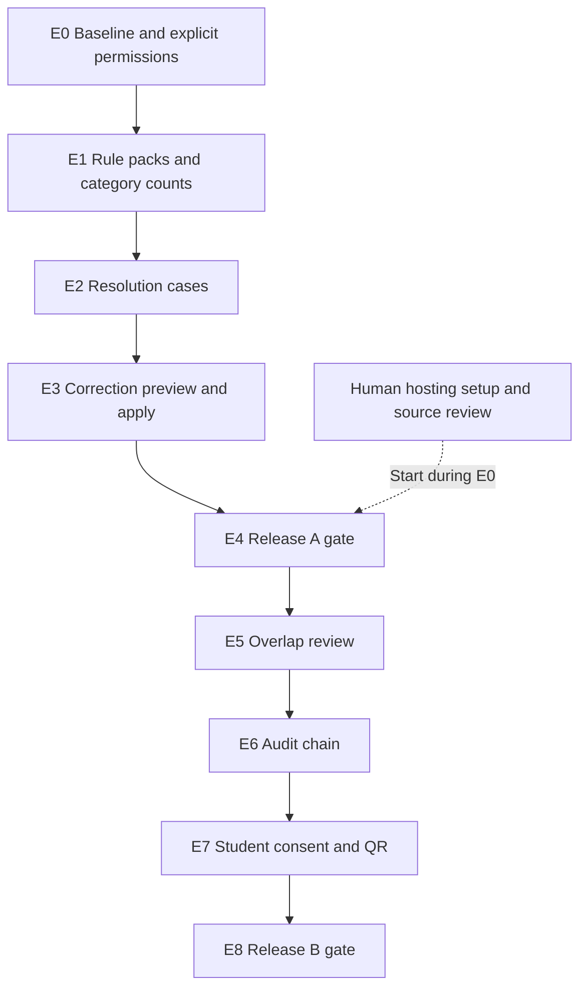

# 11 — Feature extension execution plan

Prepared on **26 October 2026**. This plan extends the existing application. It does not rebuild it. **E0–E3 and E5 are implemented and locally tested. E4 hosting and E6–E8 remain pending.** See the checklist for current execution evidence. The requirements below remain the implementation baseline, not a claim that every phase is complete.

Recommended sequence: **explicit access rules → rule explanations and category counts → resolution desk → correction preview/apply → first release gate → overlap review → audit integrity → consent/QR → extended release gate**.

Use this plan for the new feature work. [Document 04](04-implementation-phases.md) remains the foundation/release reference. [Document 03](03-feature-specification.md) retains the core rules. This document defines the proposed extension contracts; promote each accepted contract into Documents 02/03 as its implementation starts, then keep one canonical definition.

## 1. Scope and starting point

| Requested group | Existing behaviour | Work to add | Plan phase |
|---|---|---|---|
| Resolution desk and field differences | F09 reports, correction CSV, eligible outage retries; F06 guarded commit. | Assigned cases, versioned transitions, encrypted correction proposals, preview and apply. | E2–E3 |
| Rule provenance and deterministic help, with categories | Stable issue messages and a basic intake dashboard. | Immutable rule packs, historical references, source-linked help, category counts. | E1 |
| Cross-institution overlap review | Verified people can link multiple enrolments; no overlap workbench. | Interval detection, stable cases, limited officer decisions. | E5 |
| Tamper-evident audit chain | Transactional safe audit events; no cryptographic chain. | Dedicated chain head/key, canonical HMAC events, snapshot verifier. | E6 |
| Student-approved verification and QR | Only institution/officer accounts; F12 is a specification. | Student/verifier scopes, private request addressing, consent grants, field limits, revocation, QR. | E7 |

Preserve Python 3.12, FastAPI, SQLAlchemy, Alembic, PostgreSQL, React/TypeScript, TanStack Query, and the locked dependency workflow. Native Windows/PowerShell remains supported. Vercel and Render remain the targets. No Redis, worker queue, vector database, LLM provider, blockchain, or new national identifier is needed.

Keep the current 500-row/2-MiB limit until measurements justify a change. Split new domain logic into focused modules instead of enlarging `services.py` and `App.tsx` indefinitely. Reuse existing validation, transaction, encryption, and API-client boundaries.

### How to treat the supplied “verified facts”

The pasted text is a feature/design input. Its embedded “Implement” commands are task-card proposals, not an instruction to execute all five features in this planning turn. It supplies no exact official source URLs, publication dates, or quoted passages for its policy claims.

| Supplied claim | Planning treatment |
|---|---|
| APAAR and ABC use the same 12-digit identifier. | Do not add a duplicate `abc_id` column. Keep internal UUIDs and existing enrolment keys. Record the claimed equivalence for primary-source confirmation before a real connector. An optional APAAR value cannot be the primary key of every admission. |
| 26.35 crore IDs and 153+ universities establish broad adoption. | User-supplied, undated figures; not independently verified here. Do not put them in dashboards or presentations as current official statistics. Issuance totals alone do not prove that reconciliation is the main bottleneck. |
| Demographic corrections belong to the learner or the institution, depending on the source. | Support explicit routing, but do not automatically tell every user to change Aadhaar to match a college typo. Verify which record is wrong and which authority can change it. Our application cannot update an upstream government record. |
| Dual enrolment is permitted under specific conditions. | Review overlaps; never automatically reject or label fraud. Eligibility depends on current applicable rules and facts such as course/mode, which our current CSV does not establish. |
| Alternative IDs are accepted for foreign/non-Aadhaar learners. | Requires current official workflow verification. Retain missing-ID warnings and existing flags. Do not add PAN/passport/Aadhaar collection or imply that a flag proves eligibility. |

AI can build the synthetic workflow while official source verification remains open. Missing policy evidence blocks official claims and real-data use; it does not block a clearly labelled demo.

## 2. Corrections to the supplied task cards

| Proposal needing adjustment | Execution decision |
|---|---|
| A `DATE_INVALID` case always edits an enrolment. | Some invalid rows have no enrolment. Support staged-row targets and enrolment targets explicitly. |
| Store `expected_version` as the row's current version. | Store a server-owned `version`. The client supplies `expected_version` for each mutation. Check both case and target-record versions where relevant. |
| Preview values, then accept any patch on save. | Persist an encrypted proposal. Apply that exact proposal after fresh scope, version, rule, and intake checks. |
| Use only the six example rule codes. | Cover all actual emitted codes, including `APAAR_INVALID_FORMAT`, `APAAR_NOT_FOUND`, `APAAR_INACTIVE`, `IDENTITY_REASSIGNMENT`, and `DUPLICATE_IDENTITY`. Do not rename existing codes silently. |
| Sum general, supernumerary, NRI, OCI, and foreign counts. | Base/supernumerary can partition admissions. NRI/OCI/foreign flags may overlap that partition and each other. Show dimensions separately. |
| Detect overlaps only on upload or retry. | Also reconcile after lifecycle/date corrections and identity changes. Preserve closed and superseded review history. |
| Lock the latest audit row and use a bigserial as chain order. | Use a permanent chain-head row. A latest-row lock fails on an empty table and can fork under concurrency. Allocate committed chain order under the head lock. |
| Reuse `HMAC_KEY` for audit and consent. | Preserve the current identity-lookup key. Add separate audit and grant-token secrets when those features are enabled. |
| Allow every signed-in user to verify the global audit chain. | Global verification is officer/operator scope. Institution accounts retain only their own audit view. |
| Put a grant token in an API path. | Prefer a frontend fragment link and an authenticated POST with the token in the body. Hosting logs can capture path tokens even if application logs redact them. |
| Add student/verifier roles to existing guards. | First replace “no institution means global scope” with explicit role permissions. Audit every current route before exposing new roles. |

## 3. Dependency flow and release cuts



**Release A — recommended short-deadline target:** existing core plus deterministic rule help, illustrative categories, resolution cases, and safe correction previews. This is already a substantial extension. Do not promise all five groups in two days. If time is insufficient, ship only completed slices and clearly list the rest.

**Release B:** overlap workbench, audit integrity, and the complete consent/QR flow. These require separate concurrency, permission, and failure-path work. A half-built student portal or QR endpoint must not be exposed.

Local implementation can continue while hosting/source-review tasks are pending. Each advertised hosted release must still pass its own release gate. These are dependency phases, not a day-by-day schedule.

Ownership: **AI** implements and checks; **HUMAN** supplies authority, account/cost decisions, and real policy review; **SHARED** means AI prepares a concrete result for user/workflow review. Routine reversible code work does not need repeated confirmation.

## 4. E0 — Establish contracts and explicit permissions

**Outcome:** extensions can be added without changing existing identity/count rules or giving new accounts officer access.

**AI tasks**

1. Read `AGENTS.md`, the current checklist, models, validators, routes, and frontend API types. Run a baseline when implementation starts; record its actual result rather than copying the old test count.
2. Introduce explicit permission dependencies and scoped repositories. Inspect `query_scope`, `owned`, `/institutions`, `/programmes`, `/batches`, `/enrolments`, `/dashboard`, templates, exports, and audit routes. The current `institution_id is None` shortcut is valid only for the two existing roles; it cannot authorise new roles.
3. Define additive API schemas, domain errors, unique/check constraints, and migration order. Preserve existing enrolment canonical keys and person linkage.
4. Define one lock order for all affected writers: operation headers (batch/proposal) → sorted programme IDs → sorted person IDs → sorted enrolment IDs → case/review/request/grant rows → audit head. Resolve IDs before locking where necessary. Do not acquire new business locks after the audit head.
   For unverified-to-verified promotions, run the mock identity resolution and resolve/create the target person or acquire a transaction lock on its keyed APAAR digest **before** locking the enrolment. Then lock people/digests in sorted order and lock/reload the enrolment. Recheck its version before mutation. Never discover and acquire a new person lock while already holding an enrolment lock; rollback/retry from the operation boundary if discovery changes the lock set.
5. Keep seed idempotent, existing data intact, and registry labels visible. No database reset is part of this plan.

| Role | Permitted work after the relevant phase | Explicit limit |
|---|---|---|
| Institution administrator | Own records/cases/corrections; own counts; read rule help. | No foreign objects, global overlap queue, other-institution facts, or global chain verification. |
| Officer | Existing scoped cross-institution reads; E5 review decisions; E6 integrity check. | New write permission applies only to review decisions. It does not grant enrolment/programme edits or consent approval. |
| Student, added in E7 | Own linked enrolments, request inbox, grant approval/revocation. | No institution lists, batch exports, dashboards, or another person's records. |
| Verifier, added in E7 | Its requests and currently approved fields for its grant. | No person search, ordinary enrolment/batch endpoints, or reuse of another verifier's grant. |
| Unknown/inactive/unauthenticated | Health and any explicitly public non-personal shell only. | Deny all protected data and mutations. |

**HUMAN:** begin hosting/project setup and secure access; provide official source links when available. **SHARED:** adopt the synthetic release cut and review the permission table. Use this proposed baseline for independent local work without waiting for optional preferences.

**Exit gate:** existing institution/officer behaviour still passes. Unknown roles fail closed. A route-permission test matrix covers the existing API before student/verifier accounts are activated.

## 5. E1 — Rule provenance, deterministic help, and categories

**Outcome:** each issue explains the applicable demo rule, next action, and historical version. Counts stay honest.

**AI tasks**

1. Create a versioned rule catalogue. Each entry needs `issue_code`, severity, explanation, next steps, allowed owner types, `authority_label`, source URL/reference, applicability, nullable effective/review dates, and review status. Label unverified sources and demo assumptions honestly; do not invent a human review date.
2. Snapshot immutable rule packs in PostgreSQL or a versioned manifest with retained content and digest. Pin `rule_set_id` on each batch and correction proposal. A mutable dictionary with only a version string is insufficient.
3. Backfill existing batches to a clearly labelled legacy pack derived from the core baseline. Do not claim this proves historic official policy. Preserve their original report contents.
4. Historical help must resolve the pinned pack. Commit/apply must use a supported pinned validator or refuse with a re-preview instruction if that version is no longer executable. Never silently revalidate old data using different current rules.
5. Add authenticated, read-only `GET /api/v1/rules` and `GET /api/v1/rules/{issue_code}?rule_set_id=...`. Unknown code/pack returns `404`. Extract code coverage from the actual rule/registry/service sources, not only the pasted examples.
6. Add an issue drawer with “Why”, “Who can act”, “Next steps”, “Source”, and “Version”. Use deterministic text; no LLM/network call in the decision path.
7. Extend the scoped dashboard with the category contract below and a simple show/hide control. Invalidate relevant TanStack Query data after real mutations.

**Count contract**

- Use the same programme/year/business-date and active-enrolment scope as the existing dashboard. Include all identity states.
- `base_count`: active records with `supernumerary=N`; `supernumerary_count`: active records with `supernumerary=Y`. For valid current rows, their sum equals `active_total`.
- `nri_count`, `oci_count`, and `foreign_national_count` are independent flag counts over active records. Explain that they can overlap. A record with both `supernumerary=Y` and `nri=Y` is one admission, shown in two different dimensions.
- Do not call base seats “general reservation seats”. `seat_type` is currently bounded text, not an authoritative quota taxonomy. Do not turn it into a quota policy by inference.
- Label the view **“Illustrative category breakdown — not an official compliance calculation”**. Preserve the existing basic intake comparison. Do not subtract categories from intake, apply percentage caps, or certify compliance without applicable reviewed policy.

**HUMAN:** check source applicability and correction wording. Demo-only rules can ship with their labels while official review remains pending.

**Exit gate:** every emitted issue has an explanation; changing the current catalogue leaves old batch help unchanged; unknown code/version fails; a mixed-category fixture proves dimensions do not inflate active totals; institution filters and officer scope work.

## 6. E2 — Resolution desk and state machine

**Outcome:** staff can track an issue and the next responsible party, including issues on rows that have never been committed.

**Proposed data**

`resolution_cases`: UUID, institution FK, subject kind (`STAGED_ROW` or `ENROLMENT`), exactly one matching subject FK, issue code, rule-pack FK, owner type (`COLLEGE_STAFF`, `STUDENT_ACTION`, or `UPSTREAM_AUTHORITY`), optional same-institution assignee, status, bounded resolution reason/evidence kind, server `version`, and UTC timestamps. An optional origin-row reference can preserve provenance after a staged row becomes an enrolment. Enforce subject/institution consistency server-side and with supported database constraints.

`resolution_case_events`: case FK, actor FK, prior/new status, owner change, reason code, related correction/recheck ID, and timestamp. No free-text personal notes. Existing safe audit remains mandatory in the same transaction.

Create at most one open case per target/issue episode. Use a database uniqueness rule and an idempotent service. Where the canonical institution/programme/year/student reference is known, reconcile repeated row submissions to the same work item. An unassignable row stays attached to its own staged-row evidence; do not merge people by name/DOB. Retain all origin links and resolution history.

**State contract**

| State | Allowed next state | Required condition |
|---|---|---|
| `OPEN` | `WAITING_ON_USER`, `WAITING_ON_AUTHORITY`, `READY_TO_RECHECK` | Authorised owner/action and current case version. |
| Waiting state | `READY_TO_RECHECK` or `OPEN` | An action is reported or routing is corrected; this is not official verification. |
| `READY_TO_RECHECK` | `RESOLVED`, `OPEN`, or an appropriate waiting state | Service revalidates; the targeted issue must actually clear before resolution. |
| `RESOLVED` | `OPEN` | A new/reopened episode with an audited reason; retain prior closure evidence. |

E3 can atomically resolve a case when its local correction clears the targeted issue. Initial closure reasons are `LOCAL_CORRECTION_APPLIED`, `MOCK_RECHECK_PASSED`, and `SOURCE_ROW_REPLACED`; each requires a linked successful operation and cleared targeted issue. A reported upstream fix alone cannot produce an official verified result. Other issues on the same record retain their own status. A blocking targeted error that remains must prevent closure (`422`). Routing records a staff workflow state; it does not send messages or change an upstream system.

**AI tasks:** migration and model → transition service → scoped list/detail/mutation routes → meaningful tests → Resolution Desk UI. Add `GET /api/v1/resolution-cases`, `GET /api/v1/resolution-cases/{id}`, and `PATCH /api/v1/resolution-cases/{id}`. The PATCH requires `expected_version` and explicit allowed changes; it is not a generic student-record patch.

Expose owner/status/code filters, pagination, age, next action, and case history. Server-side filters enforce scope. Expected failure contract: foreign subject `404`, stale version `409`, invalid transition/false closure `422`, unpermitted role `403`.

**HUMAN:** review the difference between college correction, learner action, and an upstream authority. Do not require a real student's identity or contact data to demonstrate the routing.

**Exit gate:** a held `DATE_INVALID` row can have a case without an enrolment; a mismatch can be routed without exposing other records; repeat discovery produces no duplicate open case; closure/reopen/history and rollback tests pass. Inline editing is not advertised yet.

## 7. E3 — Exact correction preview and transactional apply

**Outcome:** a reviewer sees the proposed change and saves that change once, without stale overwrites or count inflation.

The existing `EnrolmentPatch` changes lifecycle fields only. It cannot safely accept arbitrary identity/date edits. Add a dedicated correction service that reuses `StudentRow`, structural checks, mock identity checks, content/uniqueness checks, intake rules, and safe audit/history. Do not bypass F04/F06 by directly changing model attributes.

**Proposed data and API**

- `correction_proposals`: UUID, institution/actor/case/target references, encrypted proposed row/patch, payload digest, expected case/target versions, pinned rule pack, previewed programme/intake inputs, expiry, and applied/result references. The server owns this record. Use a short documented demo expiry, initially ten minutes.
- `POST /api/v1/resolution-cases/{id}/correction-previews`: validate the proposed correction, store it encrypted, and return a proposal ID, safe field differences, issues, current/expected versions, and projected created/updated/unchanged/held/active deltas. Creating a proposal does not change main enrolments or close a case.
- `POST /api/v1/correction-proposals/{id}/apply`: accept the proposal ID and expected versions, not a fresh unrestricted patch. Scope to its institution and author in this release. Repeated successful apply returns the original result with no additional changes.

**AI implementation order**

1. Add a server-owned `version` for mutable case/preview targets. Capture expected enrolment versions, or an “expected absent” condition for a new canonical key, when batches/previews are made.
2. Extend ordinary batch commit checks as well as inline apply: a stale earlier batch must not overwrite a correction. Legacy previews without a safe snapshot require a new reviewed preview. Preserve original staged input as evidence.
3. For an enrolment target, keep institution, programme, year, and student reference immutable in the inline first version. Identity reassignment to a different person remains blocked for review. A staged row may correct a missing/unknown programme, but must resolve within the owning institution and pass uniqueness checks.
4. Calculate field differences and intake effects from current database state. Mask identifiers. Names/DOB are available only where the owning editor needs them; do not add a general raw-row endpoint or include them in history/audit metadata.
5. At apply, take the agreed locks, recheck current permissions/versions/rule execution/identity results/uniqueness and previewed count inputs. Reject an expired/changed proposal with `409` and require review again. Never trust a client-supplied intake delta.
6. Save enrolment, original-row/proposal lineage, applicable case changes, history, audit, and apply result atomically. A previously blocked row becomes a validated canonical insert/update; retain the original error report. An origin preview that could replay old values must be superseded or refused as stale.
   Mark the repaired source `batch_rows.status` as `SUPERSEDED_BY_CORRECTION` (the current column is `status`, not `row_status`) and link its correction result. F08 excludes that row from current held/unassignable work in the same transaction. A fixture with one assignable held candidate must go from one to zero immediately after repair; deduplicated candidate totals can change by a different amount if repeated origins or an existing enrolment are involved. Preserve `upload_batches.summary`, original issues, and encrypted input as the historical dry-run snapshot.
7. Close only cases whose targeted issue has cleared. Invalid corrections remain reviewable and produce no partial enrolment writes. A mock match must remain labelled mock.
8. Build the side-by-side modal: changed fields, “one record updated; zero new admissions” when true, remaining issues, and the explicit Apply action. Refetch case, record, batches, dashboard, and history after success.

**HUMAN:** try one local typo correction, one missing-ID correction, and one held-row repair. Check that the change and ownership are understandable.

**Exit gate:** no pre-apply main-record writes; forged/changed proposal payload refused; stale case/record/intake/rule or identity result refused; unchanged apply is a no-op; duplicate apply is safe; older batch cannot overwrite a newer correction; injected failure rolls back record, case, audit, and result together.

## 8. E4 — Release A gate

**AI:** run the selected feature tests and the full regression checks once this release is assembled. Add a browser journey for upload → case → preview → apply → counts/history, plus a foreign-institution denial. Reproduce setup/migrations on a fresh disposable database and upgrade a populated synthetic baseline without data loss.

Deploy with authorised hosting access. Verify exact CORS origins, HTTPS, PostgreSQL TLS, retained keys, direct SPA routes, restart persistence, and a real browser/API journey. Measure the supported maximum on the actual host before advertising it.

**HUMAN:** authorise projects/costs, enter persistent secrets securely, review demo-account exposure, and rehearse. If access is absent, record “local passed; hosting blocked” and continue independent local work. A configuration file is not a deployment result.

**Exit gate:** Release A checklist has actual evidence and a recoverable synthetic dataset. Incomplete Release B routes remain unavailable.

## 9. E5 — Cross-institution overlap workbench

**Outcome:** an officer can review an explainable date overlap without automatically rejecting a learner or leaking the other institution's data.

**Proposed data:** `overlap_reviews` with canonical ordered enrolment pair, person FK, interval/evidence snapshot, both enrolment versions, server review version, status, reviewer/reason/policy-reference fields, and UTC timestamps. Unique pair plus retained review events prevents duplicate active work and preserves past decisions.

**AI tasks**

1. Define inclusive date intervals for this synthetic version: `[start_date, end_date]`, with no end treated as open-ended. Therefore `end_A < start_B` is non-overlapping; equal boundary dates trigger a one-day review. Label this a demo convention until an applicable policy is reviewed.
2. Match only a shared verified `person_id`. Use indexed SQL interval predicates or PostgreSQL `daterange`; no fuzzy-name merge or new external service. Include historical completed/transferred intervals. Do not limit detection to active status or the same academic year. Label future-only intersections as scheduled rather than already occurring.
3. Reconcile pairs after commit, correction, lifecycle/date edits, and eligible identity rechecks. Lock shared people in stable order before detection. Two simultaneous cross-institution commits must not both miss the other's new enrolment. Every writer must follow the same lock order.
   Promotions in correction/retry must resolve the mock result and target person/digest before acquiring enrolment locks, as required by E0. Test concurrent promotions and a lifecycle edit with a finite database lock timeout; assert completion and exactly one review pair.
4. Use statuses `OPEN`, `REVIEWED_PERMITTED_DUAL`, `REVIEWED_TRANSFER_LAG`, `ESCALATED`, and `NO_LONGER_OVERLAPPING`. A change to evidence reopens or updates the review under a documented rule; a prior “permitted” decision cannot silently cover changed dates.
5. Add officer-only `GET /api/v1/overlap-reviews`, detail, and versioned `PATCH /api/v1/overlap-reviews/{id}`. Permit only review status/reason changes. Keep enrolment/programme editing denied to officers.
6. Return institution/programme/date/status evidence and a masked identifier to the officer, without names/DOB/raw APAAR. Institution users get at most a generic notice on their own record, with no other institution name, pair/person ID, exact foreign dates, or review queue access.
7. Add an officer workbench with a source-linked reason and evidence dates. It must say “review required”, not “fraud found”. No overlap result blocks a valid admission commit.

**HUMAN:** confirm any official dual-enrolment policy and review reasons. The existing CSV lacks course-mode facts, so the detector cannot automatically decide whether a dual enrolment is permitted.

**Exit gate:** simultaneous verified enrolments produce one review; sequential transfers produce none; same-day boundaries follow the stated convention; historical overlaps are found; unverified similar names produce none; concurrent commits create one pair; corrected dates reconcile/reopen cases; foreign details stay hidden.

## 10. E6 — Tamper-evident audit integrity

**Outcome:** detect changes to retained chained events under a stated threat model. This is not an immutable ledger or a blockchain.

**Proposed data:** add `chain_version`, `key_id`, `sequence_no`, `prev_hash`, and `event_hash` to chained audit events. Add a permanent singleton `audit_chain_head` with last committed sequence/hash and chain epoch. Keep existing event IDs and personal-data exclusions.

**AI tasks**

1. Introduce a separate base64 32-byte `AUDIT_HMAC_KEY` and explicit key ID. Do not reuse or rotate `HMAC_KEY`, `PII_KEY`, or JWT secrets. Extend typed settings, ignored-local setup support, secret templates, and deployment guidance without replacing existing `.env` values. Preserve historical verification keys when rotation is later added.
2. Define a versioned canonical event representation. Include event ID, chain/version/key ID, sequence/previous hash, actor, institution, action, entity, request ID, explicit UTC timestamp, and safe metadata. Use deterministic JSON and unambiguous timestamp encoding; do not concatenate ambiguous unescaped fields or log the key/payload.
3. In the existing mutation transaction, lock the head row, allocate `head.sequence + 1`, compute HMAC-SHA256, append event(s), and update the head. Acquire the head only after business locks and perform no further business locking. Allocation rolls back with the transaction. A serial database sequence alone is not committed chain order.
   The Alembic migration inserts the singleton genesis head (`sequence_no=0`, `last_hash="0" * 64`). For schema-only/truncated test setups, the writer uses idempotent `INSERT ... ON CONFLICT DO NOTHING` before locking the head. A missing head with existing chained events is an integrity error, never permission to restart the chain. Test fresh migrations, metadata-created schemas, and first-write concurrency without requiring a separate seed command. Supply independent synthetic `AUDIT_HMAC_KEY` and `GRANT_TOKEN_KEY` through test settings when those features are introduced; never fall back to hard-coded application keys.
4. Define a controlled migration cutoff. Preserve old events and create a documented legacy baseline/epoch under a write pause or migration lock. If old events are chained during migration, that attests only to the imported snapshot, not their original authenticity. Never silently fabricate historical integrity.
5. Add officer-only `GET /api/v1/audit-events/verify`. Use a consistent read snapshot and captured head watermark. Verify canonical hashes, sequence continuity within the epoch, previous links, and the captured head. Report checked count, through-sequence, last hash, and first detected failure location when known.
6. Check head agreement to detect tail deletion where the head remains intact. Return “unavailable/unknown key” rather than verified success if a required key is missing. Verification is read-only; do not append a new chain event merely for verifying the chain.
7. Add the integrity button/result to the officer Activity view. Institution users retain their own safe history without a global chain disclosure.

**Threat boundary:** a database-only attacker without the audit key cannot recompute a valid chain over edited events. An application/key compromise can forge events. Restoring an old database together with its old head can hide later events unless an external trusted checkpoint exists. External anchoring is deferred; do not claim rollback-proof or tamper-proof operation. The global head also serialises audit appends; measure its bounded demo behaviour before any scale claim.

**HUMAN:** preserve the new secret across restarts/deploys and approve the migration window for a shared environment. No approval is needed to test a migration on a designated disposable local database.

Demo scheduling: E5/E6 may proceed as isolated slices if E3 has an unresolved edge case. E0 and each slice's own transaction/privacy tests still gate it. E6 must cover genesis, upgrades, concurrent writers, and verification; it is not considered complete based on a line-count estimate. An unfinished E3 remains unavailable, and Release A cannot claim inline correction until its checks pass.

**Exit gate:** empty genesis and concurrent first writers are safe; concurrent mutations form one chain; failed business/audit writes roll back together; metadata/action edits and middle deletion fail; tail deletion disagrees with the head; verification during concurrent writes uses a stable watermark; unknown key fails safely; existing identity lookup/decryption remain unchanged.

## 11. E7 — Student-approved selective verification and QR

**Outcome:** a specific verifier receives only the fields a linked student approved, until expiry/revocation. Build the permission path before exposing QR links.

### E7a — Principals and private request addressing

**AI:** migrate the role/scope constraints, not just the role enum. Add a student profile bound to one person and a verifier profile bound to an approved organisation. A student cannot self-link by entering someone else's APAAR/DOB. Seed an adult synthetic student, a second student for isolation tests, and two verifiers to test wrong-recipient denial. Preserve existing accounts/passwords and run the seed twice.

Apply E0's explicit route permissions to the actual new users. Add a narrow own-enrolment view and request inbox. Do not expose generic institution or enrolment search to a verifier.

For requests, let the student create an expiring, high-entropy record handle from an own-enrolment screen. Store its digest and bind it to that student/record. A verifier can submit the handle with a bounded purpose and requested field list. The handle requests consent; it grants no record access. Use rate limits and a generic acknowledgement for request submission to avoid a person-existence oracle.

**HUMAN:** approve who may bind student identities and verifier organisations before real use. Demo profile links remain synthetic. Guardian/minor workflows are outside this adult demo; do not imply they exist.

### E7b — Requests, approval, and grants

**Proposed data:** `verifier_organisations`, student/verifier profiles, `record_request_handles`, `verification_requests`, `consent_grants`, and bounded access/audit events. Requests need pending/denied/approved state and version. Grants bind student person, enrolment and approved record version, verifier user/organisation, purpose code, allowed-field set, token digest, expiry, revocation, and key ID. Use UTC time and foreign/check constraints.

Field whitelist: `programme`, `institution_name`, `academic_year`, `admission_status`, `start_date`, `masked_apaar`. Approved fields must be a subset of both the request and whitelist. Deny arbitrary JSON fields. Purpose cannot be an unrestricted personal-data comment. Start with a one-hour maximum demo grant; document this as a product setting rather than an official rule.

| Route | Caller and rule |
|---|---|
| `POST /api/v1/me/enrolments/{id}/request-handles` | Student owning the verified linked record. |
| `POST /api/v1/verification-requests` | Approved verifier; opaque handle, purpose, requested fields; bounded/idempotent submission. |
| `GET /api/v1/me/verification-requests` | Student's own inbox only. |
| `GET /api/v1/me/verification-requests/submitted` | Verifier's own submitted requests/status only; no unapproved record fields. |
| `POST /api/v1/me/verification-requests/{id}/approve` | Linked student, current request version, allowed field subset, bounded expiry. |
| `POST /api/v1/me/verification-requests/{id}/deny` | Linked student; versioned and audited. |
| `POST /api/v1/me/consent-grants/{id}/revoke` | Grant's student; immediate server-side revocation. |
| `POST /api/v1/verification/resolve` | Authenticated bound verifier; opaque token in request body. |

Use a separate `GRANT_TOKEN_KEY` for digesting random tokens of at least 256 bits. Store only the digest. Reveal the verification token/link once on approval. Repeated approval returns existing grant metadata without silently minting a second grant or trying to recover the token. If delivery is lost, an explicit reissue revokes the prior grant and creates a new one.

On resolve, check active caller/organisation, digest, current grant, student/record scope, purpose/fields, expiry, revocation, and bound record version. A changed record requires renewed consent; never silently disclose new data under an old approval. Guessed, wrong-verifier, expired, revoked, or changed-record tokens return the same safe unavailable response to an authenticated caller. An unauthenticated caller receives `401`.

Serialize resolve/revoke against the live grant. After revocation commits, a request that checks the grant afterward must fail. A request already authorised before revocation may finish; do not promise that revocation retracts data already delivered. Persist safe access audit before returning data; audit failure must not produce a disclosure response.

### E7c — Consent screens and QR delivery

Add a student inbox/detail view showing recipient, purpose, selected fields, expiry, approve/deny/revoke, and access history. Add a verifier request form/status view and a result that renders only the approved response fields.

Encode a frontend URL such as `/verify#token=<opaque-value>` in the QR. The browser captures the fragment into memory, removes it from the visible URL with history replacement, and posts it to the resolve endpoint after sign-in. Never send it in an analytics event, GET path/query, redirect return URL, log, or audit event. Reload may require rescanning; do not persist the token in browser storage. A QR-rendering package, if needed, must be pinned and locked.

Use `Cache-Control: no-store` and `Referrer-Policy: no-referrer` for sensitive flows. Inspect application, Uvicorn, hosting, proxy, and frontend telemetry behaviour. No unauthenticated record view, QR-embedded personal data, official certificate assertion, or “permission by possession of QR” is permitted. “One-time reveal” does not mean one-time use: the same authorised verifier can resolve until expiry/revocation under the live checks.

**Exit gate:** approval/denial/reissue/revocation work; student A cannot act on B's requests; verifier B cannot reuse A's token; field escalation, expired handles/grants, changed records, inactive organisations, and concurrent revoke are tested; tokens/PII are absent from captured logs; the browser journey passes end to end. Only then enable the student/verifier navigation and QR feature.

## 12. E8 — Release B and the full demonstration

**AI:** assemble only passed feature slices, run regression/negative/concurrency checks, verify upgrades from populated Release A, and deploy using persistent new keys. Confirm the new role matrix on the hosted API, not only menu visibility. Rehearse rollback by disabling feature entry points and deploying compatible code; retain data, key versions, and historical rule packs. Do not rely on destructive schema downgrade or resetting a shared database.

**SHARED:** demonstrate correction → honest counts → overlap review → audit integrity → selective verification → revoke. State whether each result is mock, local, or hosted. Record actual selected limits and known limitations.

**Exit gate:** all advertised paths pass against the deployed revision; restore/start instructions preserve decryptability and chain verification; human presentation/account decisions are complete. Real-data production remains a separate F15/F16 gate.

## 13. Migration, configuration, and code boundaries

Use additive Alembic revisions in this order: rule snapshots → cases/events → correction proposals and stale-preview protection → overlap reviews/events → audit head/chain metadata → role profiles, request handles, requests, and grants. One ordered migration owner is sufficient; this plan does not require parallel agents.

Test both fresh schema creation and populated upgrades. Backfill first, validate, then tighten constraints. Never rewrite staged evidence, reset passwords, relink people, rotate existing encryption keys, or drop records as an installation shortcut. Retain legacy audit/rule provenance with honest labels.

Suggested focused modules: `permissions.py`, `rule_catalog.py`, `resolution.py`, `corrections.py`, `overlaps.py`, `audit_integrity.py`, and `verification.py`, with typed schemas and dedicated routers as needed. Existing entry points can delegate to them. The service owning a mutation owns the transaction; helpers do not commit independently. Frontend pages/components should use the existing API client and TanStack Query rather than embedded mock results.

New settings are needed only when their feature is implemented: audit key/key ID for E6 and grant key/key ID, grant TTL, and feature enablement for E7. Validate enabled-feature secrets without printing values. Existing `.env` files need an explicit additive upgrade path; the current initializer intentionally preserves them. Keep new capabilities disabled until migrations, settings, and tests are complete.

## 14. Required evidence and fixtures

All fixtures must be synthetic. New suite names below are planned, not files or passed tests already delivered.

| Fixture/check | Required observation | Suggested test location |
|---|---|---|
| Unknown/new-role access matrix | No inherited officer access; existing two roles remain correct. | `test_extension_permissions.py` |
| Two rule packs | Old batch explains old pack; unsupported executable version refuses commit. | `test_rule_catalog.py` |
| Mixed category flags | Base + supernumerary equals active; overlapping nationality flags do not inflate totals. | `test_category_counts.py` |
| Held row with no enrolment | Case opens, routes, and later repairs without a fake enrolment dependency. | `test_resolution_cases.py` |
| Duplicate case discovery / stale edit | One open episode; foreign `404`; stale `409`; false closure `422`. | `test_resolution_cases.py` |
| Changed, unchanged, and repeated correction | Exact preview applies once; no extra admission; older batch cannot undo it. | `test_corrections.py` |
| Concurrent correction / injected failure | One valid final version; no partial record/case/history/audit/result. | `test_corrections.py` |
| Overlap pair and transfer | One pair for concurrent verified intervals; no pair for sequential transfer; unverified names ignored. | `test_overlap_reviews.py` |
| Concurrent person commits / changed intervals | No missed/duplicate pair; historical evidence retained; changed evidence re-evaluated. | `test_overlap_reviews.py` |
| Audit genesis, concurrency, tampering, tail removal | One chain; stable snapshot; no false verification; rollback preserves head. | `test_audit_integrity.py` |
| Two students and two verifiers | Own inbox/record scope and exact grant recipient/field enforcement. | `test_consent_verification.py` |
| Expiry, revoke, record change, lost-token reissue | Safe denial, no stale disclosure, old token invalidated, no raw-token recovery. | `test_consent_verification.py` |
| Browser journeys | Actual correction and consent/revoke responses; safe failure/empty states. | Existing frontend test/smoke structure |
| Populated upgrade and hosted restart | Records, rule history, encrypted fields, new secrets, and audit checks survive. | Migration tests plus release execution record |

Run focused meaningful checks after each slice. Run the full suites when assembling a release or when a shared permission/transaction contract changes. Do not write tests that merely mirror a hash formula or count generated mock screen elements.

Native Windows verification commands, when the implementation exists and the designated PostgreSQL test database is configured:

```powershell
Set-Location D:\Projects\appar-id\backend
uv run --frozen ruff check .
uv run --frozen ruff format --check .
uv run --frozen pytest -q

Set-Location D:\Projects\appar-id\frontend
npm.cmd run lint
npm.cmd run format:check
npm.cmd run typecheck
npm.cmd run test -- --run
npm.cmd run build
npm.cmd run smoke
```

The smoke command needs the documented synthetic API/UI/database setup. These are future implementation checks, not results of this planning update. No Ubuntu/WSL command is required.

## 15. Progress and AI handoff

Track actual implementation in [Document 05](05-progress-checklist.md). Each completed slice needs: revision, changed files/contracts, executed command/scenario, pass/fail/not-run outcome, limits, and next task. No checkbox is complete because a route or migration is listed in this plan.

Start with this bounded prompt:

```text
Read AGENTS.md, docs/index.md, docs/05-progress-checklist.md,
and docs/11-feature-execution-plan.md.

Implement E0 only. Inspect existing permissions, scope helpers, routes,
and tests before editing. Replace implicit no-institution global access
with explicit supported role permissions. Preserve current institution
isolation, officer read scope, enrolment keys, mock identity labels,
and transaction/audit behaviour. Add meaningful permission regression
tests, including unknown-role denial. Do not add student/verifier
accounts, consent routes, audit chaining, or unrelated refactors yet.

Run the relevant checks against the designated test database. Report
actual results and update the extension checklist. Use native Windows
instructions and the required repository-local Git identity. Continue
authorised reversible work without requesting routine confirmation.
```

Then issue one task at a time: E1 catalogue → E1 category view → E2 cases/service → E2 API/UI → E3 preview → E3 apply/stale-batch protection → E3 UI → E4 gate. Continue E5–E8 only as completed slices permit. Each card must name its failure cases and human dependencies; do not paste all five original task cards as a single generation request.

Human work is limited to real authority/access, source/policy review, workflow feedback, costs, secret entry, and rehearsal. AI should prepare concrete results for those decisions. No official integration, legal compliance, human review, live deployment, or new test pass is established by this plan.
