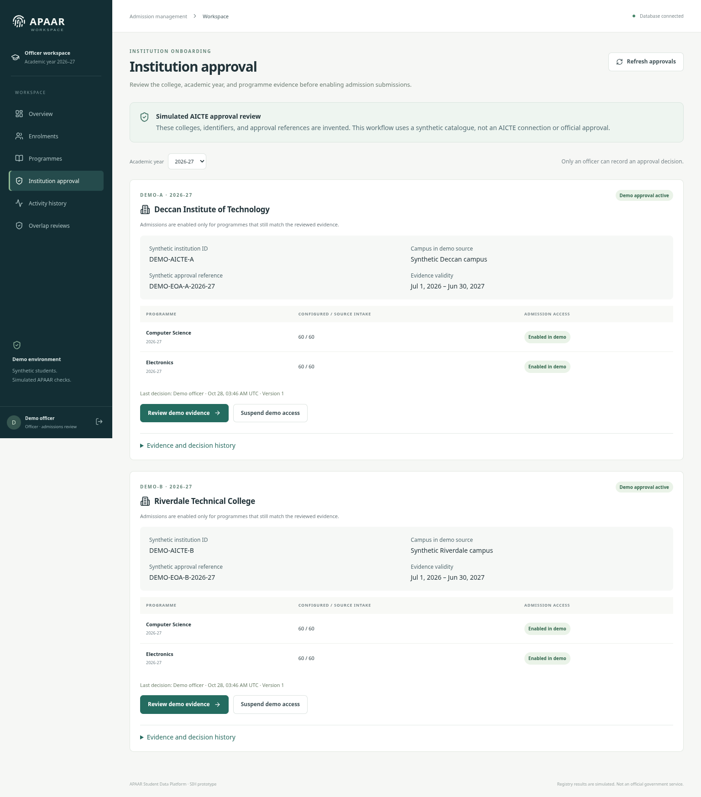
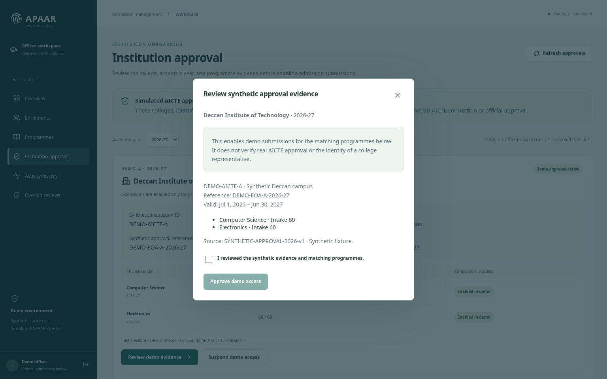
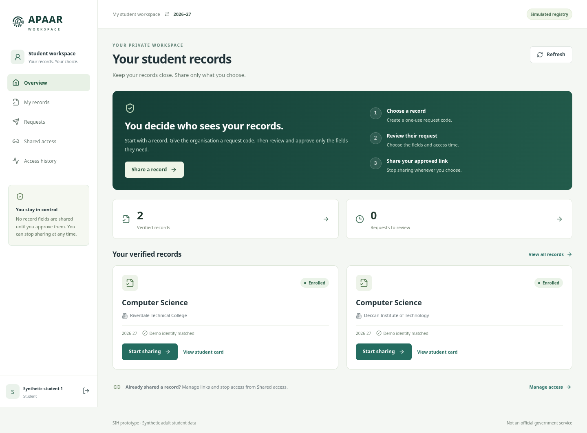
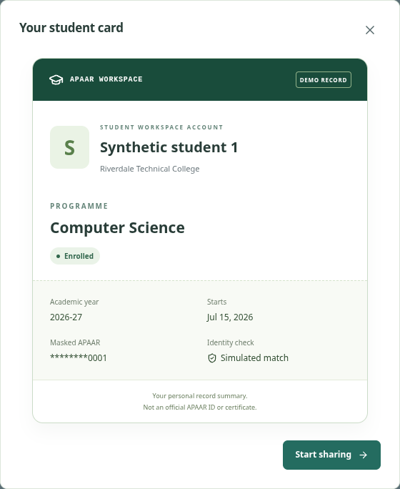
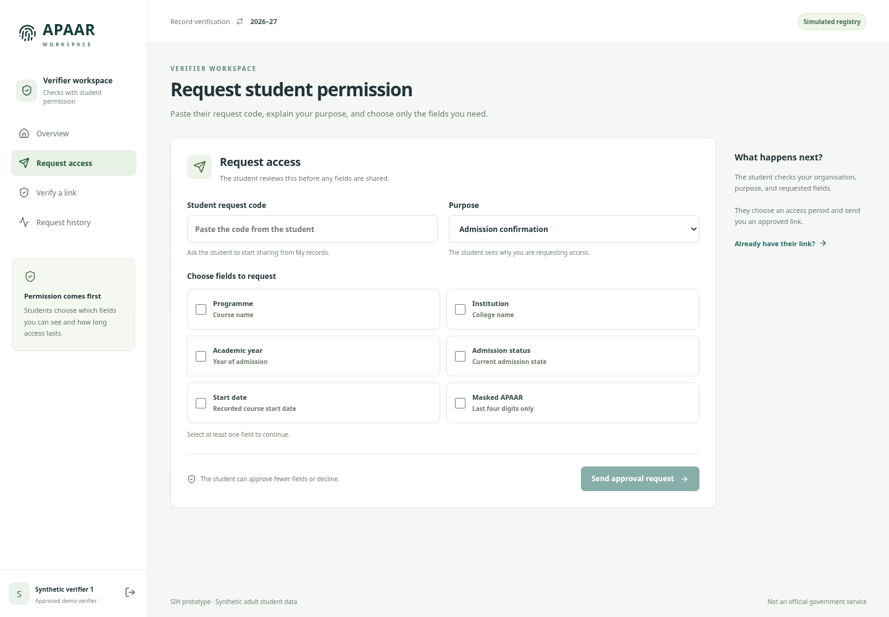
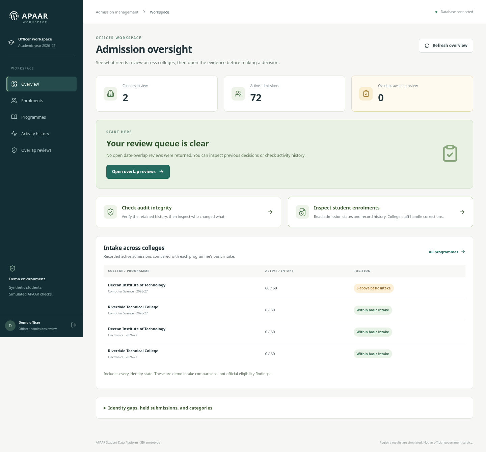
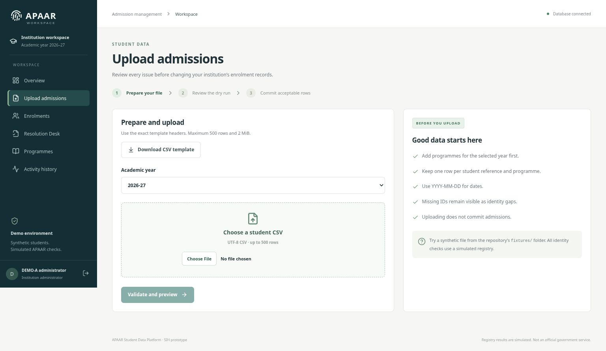
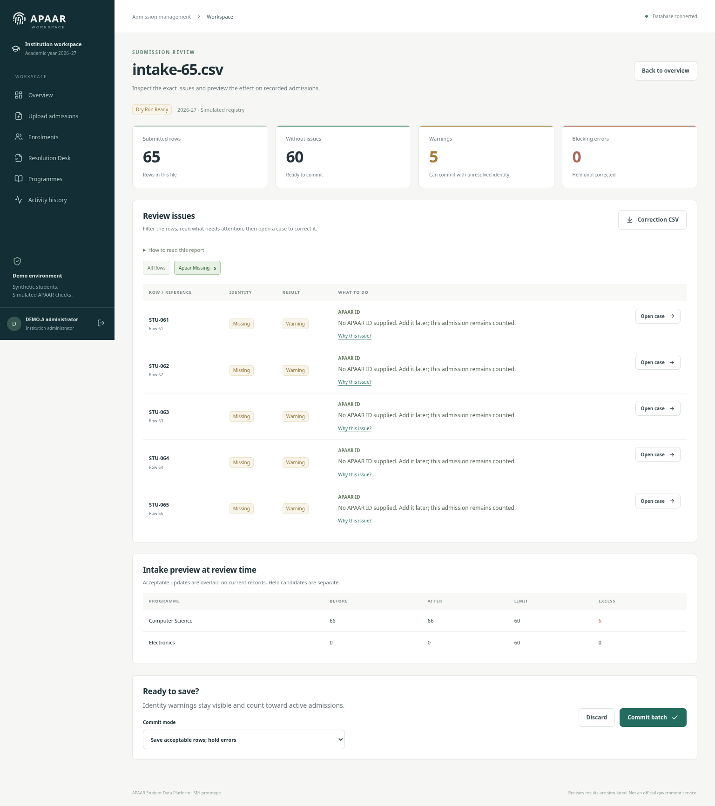

# 13 — Demo interface and role flows

These screenshots were captured from the running local application on 27 October 2026 using synthetic fixtures. Counts are examples from that dataset. This is a local demo; hosted visual checks and native Windows execution of this update remain unverified.

## Update an existing Windows demo

Stop both running servers with Ctrl+C. Pull from your actual repository root:

```powershell
Set-Location D:\Projects\appar-id\appar-id
git pull --ff-only
```

Run `uv run --frozen alembic upgrade head` from `backend`, then restart the backend and frontend in their two terminals using `scripts/Start-Backend.ps1` and `scripts/Start-Frontend.ps1`, or your existing native Windows startup commands. The 28 October institution-approval addition requires this additive migration. It preserves admissions and keys. Have the officer review the two synthetic colleges before new uploads; see [the approval guide](15-institution-approval-demo.md). For first-time extension setup, use [the complete walkthrough](12-demo-walkthrough.md).

## Institution approval: review before admission submissions

The officer and college see a separate **Institution approval** page. Colleges see only their own status; the officer reviews both synthetic institutions. The page shows the academic year, invented AICTE identifier, campus, approval reference, validity, and each programme's configured/source intake. A confirmation dialog requires explicit acknowledgement before enabling demo access. The college overview and upload page show the current approval status. Source/version evidence and previous decisions remain available.





The new screens were captured locally on 28 October 2026. The entire workflow is labelled simulated; real approval-source integration and representative identity proofing are not implemented.

## Student: find a record, view the card, control sharing

The overview explains the three steps and gives one primary action: **Share a record**. Separate navigation opens **My records**, **Requests**, **Shared access**, and **Access history**. A pending count includes only unexpired requests awaiting this student's decision. Empty, loading, and failed states explain what to do next.



The student card is available **before** any verifier request: **My records → View student card**. It shows the signed-in workspace account name, institution, programme, academic year, admission state, start date, masked APAAR, and simulated-check label. The displayed account name is not a new claim of a registry-verified legal name. The card is a personal record summary, not an official ID/certificate. It has no public or permanent QR credential.



**Start sharing** creates a one-use request code in a short guided dialog. The full-width field and copy button make the code usable without retyping. **Requests** prioritises pending work and shows the organisation, purpose, own record, and actual values for each requested field. Nothing is preselected. Approval moves to **Shared access** and brings the once-revealed QR/link into view. **Stop sharing → Confirm stop sharing** stops future access and hides the currently displayed sharing card. A replacement link explicitly invalidates the earlier link.

The personal student card and the consent QR card serve different actions. The first summarises the student's own record. The second appears after approval and allows only the named verifier to open the approved fields under live consent checks.

## Verifier: choose the right starting point

The overview offers **I have a request code** and **I have a sharing link**. **Request access** provides a compact field grid with short explanations; **Verify a link** shows only the approved result. **Request history** lists statuses and requested field names without exposing unapproved student record values. A failed link explains that it may be expired, stopped, or intended for another verifier without revealing which condition applied.



The inherited text-input/stacked-label styles were causing the oversized checkbox layout. The new field picker sets row direction and checkbox dimensions explicitly, separates labels from help text, and keeps normal text inputs full width.

## Officer: start with the review queue

The officer overview shows colleges, recorded active admissions, and open overlap reviews, with direct actions for the review queue, audit integrity, and enrolment history. Loading/failure is not shown as an empty queue. The intake table identifies each college/programme and keeps basic-intake warnings distinct from eligibility findings. An expandable breakdown retains identity-gap, held-submission, and category counts.



**Overlap reviews** defaults to **Needs review**. Each case compares the two college records side by side on desktop and stacks them on mobile. **Review this overlap → Review outcome → Save review** requires an explicit decision, reports success, and preserves both admissions. Previous decisions are accessible through the status filter. **Activity history → Run integrity check** presents the outcome first; technical details and limits are expandable.

## Interaction checks and limits

The institution upload page now keeps its fixture-folder hint in normal text flow, provides a readable native file control, and preserves navigation/sign-out at shorter desktop heights. The batch report separates each field/message/help link from its Open case button. Corrected source rows receive a clear Corrected label; the retained-report explanation is expandable.





Use [the timed video script](14-demo-video-script.md) for a short recording that follows the implemented flow.

The interface uses plain status labels, named form controls, visible focus, a skip link, copy feedback, explicit empty/error states, retry actions, and mobile sign-out. Route changes move focus to the main content. The newly revealed QR card receives focus and scrolls into view, respecting reduced-motion settings. Desktop and 390 px mobile checks cover student cards, field selection, shared access, and the officer decision dialog. The [mobile preview](assets/ux-student-mobile.png) shows the student overview.

The existing server-side roles, scopes, field whitelist, recipient binding, expiry/revocation, and audit rules remain in force. The only backend addition is an optional typed request-status filter scoped to the signed-in student. UI review and browser tests do not establish government approval, real registry access, a real-data release, or usability findings from an external user study.
